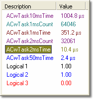

# Oscilloscope - Parameter Info

The Parameter Info Box of an Oscilloscope Window has a row showing the Name and Value of each Parameter in the Window. If the parameter in the display window does not appear in the [Live Logging Configuration](../../data-acquisition/logging/live-logging/index.md) parameter list, the value is not acquired from the control unit. In this case a dash is displayed in the Value column.

## Features

- The Parameter Info Box can be hidden by clearing **Display parameter information** in the [Extras](oscilloscope-extras.md) tab of the Window Properties dialog box, or with **Parameter Info** in the [System Menu](system-menu-oscilloscope.md).
- The colour of the text is the **Trace colour** defined for each Parameter in the [Display](../../using-system-monitor/parameters/parameter-properties/display-tab.md) tab of the Parameter Properties dialog box. The same colour is used for the trace for the Parameter in the Plot Area.
- An error symbol is shown next to a Parameter that is reporting an error condition.
- A labelled Y-axis is displayed in the Plot Area for the Parameter(s) selected in the Parameter Info Box. See [Oscilloscope - Selecting Parameters](oscilloscope-selecting-parameters.md).
- The Oscilloscope [Context menu](../../using-system-monitor/menus/context-menus/oscilloscope-context-menu.md) is available for the selected Parameter(s). It has **Copy**, **Paste**, **Select All**, **View Documentation**, **Trace Limits** and **Properties**.
- The width of the Parameter Info Box can be changed by dragging its border but the height is fixed in relation to the Plot Area. The column widths can be changed. See [Columns in Tabular Windows](../../using-system-monitor/windows/using-windows/columns-in-tabular-windows.md).

**See also:** [Oscilloscope](oscilloscope.md); [Oscilloscope - Plot Area](oscilloscope-plot-area.md)
