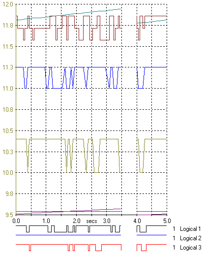

# Oscilloscope - Plot Area

The Plot Area of an Oscilloscope Window shows a plot of each Parameter against time.

## Trace Types

Three types of Trace are available (see [Types of Trace](oscilloscope-types-of-trace.md)):

- The **Linear** and **Digital** types are shown above the Timebase (X-axis).
- The **Logical** type is shown below the Timebase.

The colour of the trace (**Trace colour**) and its **Trace type** are defined for each Parameter in the Oscilloscope panel of the [Display](../../using-system-monitor/parameters/parameter-properties/display-tab.md) tab of the Parameter Properties dialog box. The same colour is used for the text for the Parameter in the [Parameter Info](oscilloscope-parameter-info.md) Box.

!!! note
    The traces only appear after the ECU has been put On Line.

## Y-Axis

A labelled Y-axis is displayed for the selected Parameter(s). Alternatively, a Y-axis can be displayed for all the Parameters in the Window by selecting **Display all y-axis** in the [Extras](oscilloscope-extras.md) tab of the Window Properties dialog box. No Y-axis is shown for Parameters displayed as Logical.

The upper and lower limits of the Y-axis can be changed for each Parameter in the [Trace Limits](oscilloscope-trace-limits.md) dialog box.

The width of the Plot Area is automatically sized to fit the Window as the Y-axes are changed and as the Parameter Info Box is resized.

## Features

- The duration of the Timebase can be changed in the [Extras](oscilloscope-extras.md) tab of the Window Properties dialog box.
- The update rate of the display can be changed in the [Display](../../using-system-monitor/windows/using-windows/window-properties-display-tab.md) tab of the Window Properties dialog box.
- The grid can be hidden by clearing the **Display the background grid** check box in the [Extras](oscilloscope-extras.md) tab of the Window Properties dialog box.
- The display is updated by a band moving across the Plot Area. This is called Band Clearing. If Band Clearing is off, the Plot Area is cleared after each sweep of the timebase. To set band clearing, select the **Band clearing** check box in the [Extras](oscilloscope-extras.md) tab of the Window Properties dialog box.

**See also:** [Oscilloscope - Parameter Info](oscilloscope-parameter-info.md); [System Menu - Oscilloscope](system-menu-oscilloscope.md)
