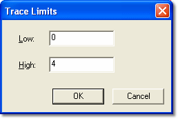

# Oscilloscope - Trace Limits

The **Trace Limits** dialog box allows the upper and lower limits of the Y-axis shown on the [Plot Area](oscilloscope-plot-area.md) to be changed for the Parameter selected in the [Parameter Info](oscilloscope-parameter-info.md) Box.

To open the Trace Limits dialog box, right-click the Parameter in the Parameter Info Box and select **Trace Limits** from the Context Menu.

To change the limits, edit the **Low** and **High** values as required and click **OK**. The default values are the Upper and Lower Engineering Limits for the Parameter as set in the [Conversion](../../using-system-monitor/parameters/parameter-properties/conversion-tab.md) tab of the Parameter Properties dialog box.

!!! note
    The Trace Limits setting has no effect on the display of a Logical trace (see [Types of Trace](oscilloscope-types-of-trace.md)).

**See also:** [Oscilloscope - Plot Area](oscilloscope-plot-area.md); [Oscilloscope - Selecting Parameters](oscilloscope-selecting-parameters.md)
