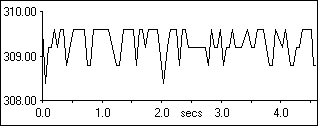
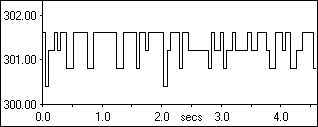
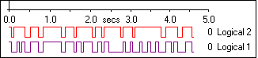

# Oscilloscope - Types of Trace

A Trace is shown in the [Plot Area](oscilloscope-plot-area.md) for each Parameter in the Window. The type of trace is defined for each Parameter with **Trace type** in the [Display](../../using-system-monitor/parameters/parameter-properties/display-tab.md) tab of the Parameter Properties dialog box.

Three types of trace are available:

## Linear

Values are joined by straight lines. The trace is shown in the Plot Area above the Timebase axis. A labelled Y-axis is shown for the Parameter(s) selected in the Parameter Info Box. This is the default.

## Digital

Values are joined by horizontal and vertical lines. The trace is shown in the Plot Area above the Timebase axis. A labelled Y-axis is shown for the Parameter(s) selected in the Parameter Info Box.

## Logical

The Logical trace has only two values: 1.00 for TRUE and 0.00 for FALSE. The parameter must have a logical output.

Values are joined by horizontal and vertical lines. The trace is shown in the Plot Area below the Timebase axis. A Y-axis is not shown but the name and value of the Parameter are shown to the right of the trace.

!!! tip
    Create a [Virtual Parameter](../../using-system-monitor/parameters/virtual-parameters/index.md) to convert the numeric output of a parameter to a logical value.

**See also:** [Parameter Properties - Display tab](../../using-system-monitor/parameters/parameter-properties/display-tab.md); [Virtual Parameters](../../using-system-monitor/parameters/virtual-parameters/index.md)
