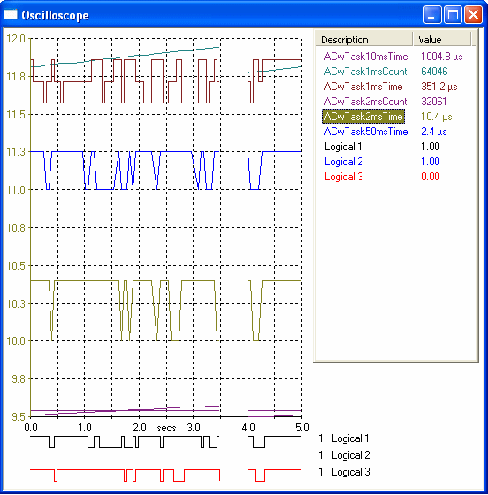

# Oscilloscope

The Oscilloscope Display shows one or more Measurement Parameters. Each parameter is displayed as a plot against time. An Oscilloscope Display window can contain any number of Measurement Parameters.

To create an Oscilloscope Window, select **Desktop** > **Window** > **Oscilloscope** (Alt+Shift+O).

The Display consists of a [Plot Area](oscilloscope-plot-area.md) and a [Parameter Info](oscilloscope-parameter-info.md) Box.

To configure the Oscilloscope Window, edit the options on the [Display](../../using-system-monitor/windows/using-windows/window-properties-display-tab.md) tab or [Extras](oscilloscope-extras.md) tab of the Window Properties dialog box, or use the [System Menu](system-menu-oscilloscope.md).

**See also:** [Creating Windows](../../using-system-monitor/windows/creating-windows/index.md); [Data Display](../index.md); [Oscilloscope - Types of Trace](oscilloscope-types-of-trace.md)
