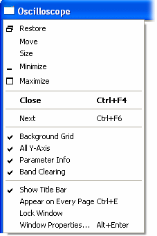

# System Menu - Oscilloscope

The [System Menu](../../using-system-monitor/menus/window-system-menu.md) for an **Oscilloscope** Window contains the following items in addition to the standard commands:

| Item | Description | Default |
|---|---|---|
| **Background Grid** | When checked, a grid is shown on the [Plot Area](oscilloscope-plot-area.md). | On |
| **All Y-Axis** | Switches between showing a labelled Y-axis for all the Parameters in the Window and showing the Y-axis only for the Parameter(s) selected in the [Parameter Info](oscilloscope-parameter-info.md) Box. The Y-axis is not displayed for Parameters with a **Logical** [Type of Trace](oscilloscope-types-of-trace.md). | Selected Parameters only |
| **Parameter Info** | When checked, the [Parameter Info](oscilloscope-parameter-info.md) Box is shown. | On |
| **Band Clearing** | When checked, the traces from the previous sweep are left on the [Plot Area](oscilloscope-plot-area.md) and are overwritten by new data. The progress of the update is shown by an empty band moving across the plot. When unchecked, the Plot Area is cleared for each sweep. | On |

These options are also available in the [Oscilloscope - Extras](oscilloscope-extras.md) tab of the [Window Properties](../../using-system-monitor/windows/using-windows/window-properties.md) dialog box.

**See also:** [Oscilloscope](oscilloscope.md); [Window System Menu](../../using-system-monitor/menus/window-system-menu.md)
