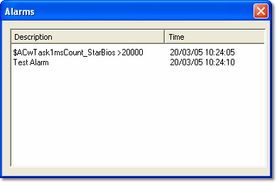

# Alarm Display

The Alarms display Window appears automatically whenever an Alarm triggers the display of a message. The Window can also be opened by selecting **Desktop** > **Window** > **Alarms** (Alt+Shift+L).

Each Alarm is displayed in a row with the following columns:

| Column | Description |
|---|---|
| **Description** | The message text as defined in the [Action](alarm-properties-action.md) tab of the Alarm Properties dialog box. |
| **Time** | The time that the Trigger condition (as defined in the [Trigger](alarm-properties-trigger.md) tab of the Alarm Properties dialog box) became TRUE. |

## Features

- A row is cleared when the Trigger condition for an Alarm becomes FALSE. The Window stays open even if all the rows are cleared.
- The default location of the Window is at the top of the Desktop, but it can be moved and resized if required.
- The column widths can be resized.
- **Appear on Every Page** is on by default for Alarm Windows (see [Window System Menu](../../../using-system-monitor/menus/window-system-menu.md)).

**See also:** [Alarms](index.md); [Alarm Setup](alarm-setup.md)
