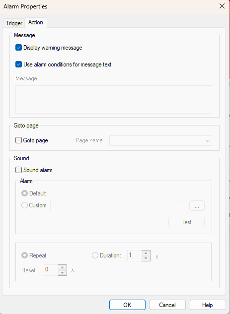

# Alarm Properties - Action

Use the **Action** tab of the Alarm Properties dialog box to edit the Actions that are carried out when the Trigger condition of an Alarm is TRUE.

The following actions are available, and may be combined in each Alarm:

- Display a message. Default on.
- Jump to a Page. Default off.
- Emit a sound. Default off.

## Message panel

The Message panel controls the format of the message:

- **Display warning message** - When selected, a message is displayed in the [Alarm Display](alarm-display.md) Window while the Trigger condition is TRUE. Default on.
- **Use alarm conditions for message text** - When selected, the text of the message is the formula used to create the Trigger condition. When cleared, the **Message Text** box is enabled. Default on.
- **Message Text** - Enter the text of the message. A message must be entered if **Display warning message** is selected and **Use alarm conditions for message text** is cleared.

## Goto page panel

- **Goto page** - When selected, the Page selected from the **Page name** list is displayed as soon as the Trigger condition becomes TRUE.
- **Page name** - Select a Page to display when the Trigger condition is TRUE. A Page must be selected if **Goto page** is selected.

## Sound panel

- **Sound alarm** - When selected, an audible alarm is sounded as soon as the Trigger condition becomes TRUE.

In the **Alarm** panel, select the sound:

- **Default** - Use the default alarm tone: the sound selected for the Windows "Exclamation" (Asterisk) system event in the Windows sound settings. Default selected.
- **Custom** - Use an audio file. Enter the file name or click **...** to browse. The file can be in `.wav` or `.mp3` format.
- **Test** - Plays the selected sound. For a custom sound, click **Test** again to stop it.

Select how long the alarm sounds:

- **Repeat** - The alarm sounds repeatedly until the Trigger condition is no longer TRUE. Default selected.
- **Duration** - The alarm sounds for the given duration, in seconds (default 1), while the condition is TRUE. Once the duration is complete, the alarm does not sound again until the alarm clears and is triggered again.
- **Reset** - The time, in seconds, before the alarm sounds again while the alarm is still active (default 0).

**See also:** [Alarm Properties - Trigger](alarm-properties-trigger.md); [Alarm Display](alarm-display.md)
