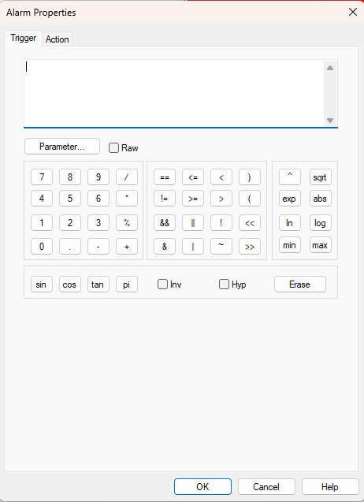

# Alarm Properties - Trigger

Use the **Trigger** tab of the Alarm Properties dialog box to create or edit the Trigger condition of an Alarm.

The trigger condition is a logical formula created from one or more Measurement Parameters combined by mathematical operators. Type the formula in the edit box, or build it with the buttons. Click **Parameter...** to insert a Measurement Parameter into the formula.

See [Mathematical Operators](../../../using-system-monitor/parameters/parameter-properties/mathematical-operators.md) for help on creating the formula.

**See also:** [Alarm Properties](alarm-properties.md); [Alarm Properties - Action](alarm-properties-action.md); [Measurement Parameters](../../../using-system-monitor/parameters/measurement-parameters.md)
