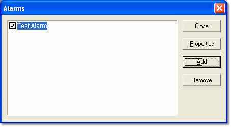

# Alarm Setup

To create an Alarm, select **Desktop** > **Alarm Triggers** to open the **Alarms** dialog box.

Each Alarm is listed in the dialog box. The Alarm text is the Message Text entered in the [Action](alarm-properties-action.md) tab of the Alarm Properties dialog box or, if **Use alarm conditions for message text** is selected, the trigger formula.

An Alarm is active if its check box is selected. If its check box is cleared, the Alarm is disabled. The Alarm is active as soon as it is created. The Alarms dialog box does not have to be closed for Alarms to operate.

| Button | Description |
|---|---|
| **Close** | Closes the dialog box. |
| **Properties** | Opens the [Alarm Properties](alarm-properties.md) dialog box for the selected Alarm. |
| **Add** | Creates a new Alarm and opens the [Alarm Properties](alarm-properties.md) dialog box at the Trigger tab. |
| **Remove** | Deletes the selected Alarm, after confirmation. |
| **Export** | Saves all the Alarms to an XML file (default name `Alarms.xml`). |
| **Import** | Replaces all the existing Alarms with the Alarms read from an XML file. |
| **Merge** | Adds the Alarms read from an XML file to the existing Alarms. |

!!! note
    Alarms that use [Locked Parameters](../../../using-system-monitor/parameters/locked-parameters/locked-parameters.md) may be hidden: their properties cannot be viewed and they are not exported.

**See also:** [Alarms](index.md); [Alarm Properties](alarm-properties.md)
