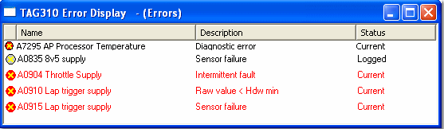

# Error Display

To create an Error Window, select **Desktop** > **Window** > **Error** (Alt+Shift+E).

Each Error is displayed as a row with the following columns:

| Column | Description |
|---|---|
| (unlabelled) | Error status symbol:  the error is Current;  the error is Logged. |
| **Name** | The name of the error in the Error file. |
| **Description** | Information about the error (usually the cause). |
| **Status** | Shows whether the Error is Current or Logged. |

## Features

- Current errors that have not been acknowledged are displayed in the **Unacknowledged Errors** colour (default red). Other errors are displayed in the window **Foreground** colour (by default the Windows text colour, usually black). Both colours are set in the [Display](../../../using-system-monitor/windows/using-windows/window-properties-display-tab.md) tab of the Window Properties dialog box.
- To acknowledge errors, make the Error Window active and select **ECU** > **Acknowledge Errors**. The colour of the Current errors changes from the Unacknowledged colour to the Foreground colour.
- To [Delete Errors](deleting-errors.md), select **ECU** > **Delete Errors** (F8).
- The number of errors listed in the Window appears in brackets after the title in the title bar.
- Specific errors can be [Masked](error-mask.md) to prevent them from being displayed.
- The column widths can be changed.
- If a new error occurs while the Error Window is minimised, the Window is automatically restored to its normal size.
- **Appear on every page** is on by default for Error Windows. See [Window System Menu](../../../using-system-monitor/menus/window-system-menu.md).
- Controls for the appearance of the Window are on the Display tab of the [Window Properties](../../../using-system-monitor/windows/using-windows/window-properties-display-tab.md) dialog box and on the Window System Menu (**Normal Font**, **Large Font**, **Show Title Bar**, **Appear on Every Page**, **Lock Window** and **Window Properties**).

**See also:** [Error](index.md); [Error Mask](error-mask.md); [ECU Menu](../../../using-system-monitor/menus/ecu-menu.md); [Window Properties - Display tab](../../../using-system-monitor/windows/using-windows/window-properties-display-tab.md)
