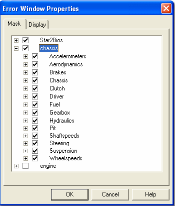

# Error Mask

Specific Errors can be masked so that they are not displayed. Select the **Mask** tab of the Window Properties dialog box for the Error Window. The Errors are listed in Error Groups in a tree format. Error Groups are allocated to an Application.

- **To mask an entire Group**, select the Group check box.
- **To mask individual errors in a Group**, expand the Group and select the check boxes of individual Errors within it. If a Group contains a mixture of masked and unmasked errors, its check box is greyed out.

## Keyboard Operation

- Use the up and down cursor keys to select a Group.
- Press the + key or the right cursor key to expand a Group, then use the up and down cursor keys to select an error.
- Press the – key or the left cursor key to collapse a Group.
- Press the SPACE bar to toggle a check box on and off.

**See also:** [Error Display](error-display.md); [Window Properties](../../../using-system-monitor/windows/using-windows/window-properties.md)
