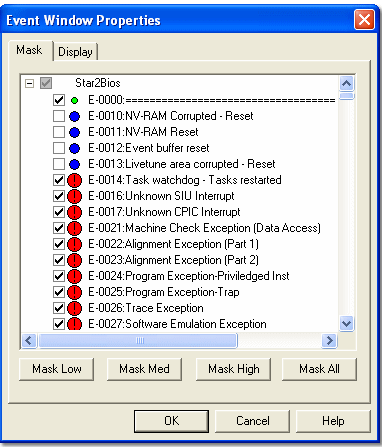

# Event Mask

Specific Events can be masked so that they are not displayed. Select the **Mask** tab of the Window Properties dialog box for the Event Window. The tab lists all the Events from the Event file in alphanumeric order.

The Events are grouped by [Application](../../../project-management/applications.md) in a tree format.

- **To mask an entire Group**, select the Group check box.
- **To mask individual Events in a Group**, expand the Group and select the check boxes of individual Events within it. If a Group contains a mixture of masked and unmasked Events, its check box is greyed out.

## Keyboard Operation

- Use the up and down cursor keys to select a Group.
- Press the + key or the right cursor key to expand a Group, then use the up and down cursor keys to select an Event.
- Press the – key or the left cursor key to collapse a Group.
- Press the SPACE bar to toggle a check box on and off.

## Mask by Priority

The symbol between the check box and the Event name shows the [Priority](event-priority.md) of the Event. To mask Events by their Priority level, use the Mask buttons. Each button toggles between Mask and Unmask depending on the status of the check boxes.

| Button | Description |
|---|---|
| **Mask Low** / **Unmask Low** | Masks or unmasks all the Events with **Low** Priority  |
| **Mask Med** / **Unmask Med** | Masks or unmasks all the Events with **Medium** Priority  |
| **Mask High** / **Unmask High** | Masks or unmasks all the Events with **High** Priority  |
| **Mask Debug** / **Unmask Debug** | Masks or unmasks all the Events with **Debug** Priority |
| **Mask All** / **Unmask All** | Masks or unmasks all the Events |

## Mask Unknown

Select **Mask Unknown** to hide Events received from the unit that are not defined in the Event file. The same option is available as **Mask Unknown Events** in the [System Menu](system-menu-events.md).

**See also:** [Event](index.md); [Event Priority](event-priority.md)
