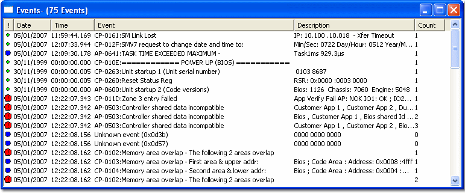

# Event

An Event is similar to an Error in that it reports on the status of the control system. However, Events have an associated date and time stamp. The Event Window displays Events received from the ECU.

To create an Event Window, select **Desktop** > **Window** > **Event** (Alt+Shift+V).

Events (names, descriptions, etc.) are defined by the Event file. An Event Window can only be displayed if an Event file is included in the Program Version.

Each Event is displayed as a row with the following columns:

| Column | Description |
|---|---|
| **!** | A symbol that shows the [Priority](event-priority.md) of the Event. |
| **Date** | The date when the Event occurred. |
| **Time** | The time when the Event occurred. |
| **Event** | The name of the event in the Event file. |
| **Description** | Three hexadecimal words that give diagnostic information about the event. Appears as text if a conversion has been provided. |
| **Count** | The number of times this Event has been received. |

## Features

- Events are displayed in the order in which they are received from the control unit, most recent at the bottom. The window scrolls automatically to always display the most recent event. The window holds a maximum of 2000 events; older events are deleted from the top of the list.
- The number of events in the Window appears in brackets after the title in the title bar, with the number of masked and trimmed (deleted) events if there are any.
- **Summary** in the System Menu switches Summary Mode on and off. In Summary Mode, only the most recent occurrence of each Event is listed.
- All events are also written automatically to a log file. See [Event Log](event-log.md).
- To save Events in a file, use **Save As** in the System Menu. See [System Menu - Events](system-menu-events.md).
- Specific Events can be [Masked](event-mask.md) to prevent them from being displayed.
- The column widths can be changed and the Events sorted by column.
- **Appear on every page** is on by default for Event Windows.
- Controls for the appearance of the Window are on the Display tab of the Window Properties dialog box and on the System Menu.

**See also:** [Event Priority](event-priority.md); [System Menu - Events](system-menu-events.md); [Window Properties - Display tab](../../../using-system-monitor/windows/using-windows/window-properties-display-tab.md)
