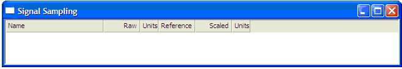

# Signal Sampling Display

To add a Signal Sampling display to a Page, select **Desktop** > **Window** > **Signal Sampling** (Alt+Shift+I).

The Signal Sampling display allows one or more input signal parameters to be sampled (zeroed) either independently or simultaneously. Parameters can be added to the display by dragging them into it from the Parameter Explorer, or with **Paste**. They can be removed by selecting the parameter in the display and pressing the DELETE key, or via the Parameter Explorer.

Multiple Signal Sampling displays can be shown on one Page.

Each input signal parameter is displayed as a row with the following columns:

| Column | Description |
|---|---|
| **Name** | The name of the input signal parameter. This is set in the [Input Signal Configuration](../data-acquisition/sensors/external-inputs/input-signal-configuration-tool.md) dialog box. |
| **Raw** | The raw (unscaled) value of the input signal. |
| **Units** | The units of the raw value of the input signal. |
| **Reference** | The scaled value the signal should read when sampled. This value can be edited. |
| **Scaled** | The current scaled value of the input signal including the offset. This is the value that will be logged. |
| **Units** | The units of the scaled value of the input signal. |

## Sampling

When a parameter is sampled, System Monitor averages its value over one second, then sets the parameter's offset so that the scaled value equals the **Reference** value.

Input signal parameters can be sampled from the current value using one of the following commands:

| Command | Where | Shortcut | Description |
|---|---|---|---|
| **Sample Selected Only** | Context menu of a parameter | Ctrl+Alt+Shift+S | Samples the selected parameter(s) only. |
| **Sample Entire Display** | Context menu of the display or a parameter | Ctrl+Alt+Shift+D | Samples all parameters in the current Signal Sampling display. |
| **Input Signal Sample Entire Page** | **Logging** menu | Ctrl+Alt+Shift+P | Samples all parameters on all Signal Sampling displays on the current Page. |

!!! note
    The sampling commands are only available when System Monitor is On Line to the unit and the display contains at least one parameter.

If one or more parameters have been sampled, download the logging configuration to the unit so that the changes are applied. The ECU bar indicates if your current System Monitor logging configuration differs from the one on the unit.

**See also:** [Data Display](index.md); [Input Signal Configuration Tool](../data-acquisition/sensors/external-inputs/input-signal-configuration-tool.md)
