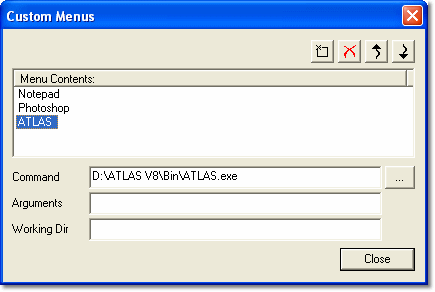

# Custom Menus

System Monitor includes a facility to run external applications.

Custom Menus creates additional entries at the bottom of the **Tools** menu, which run executable files. The Custom Menu facility can be used for [Scripts](../../activex-automation/index.md), and the [Motion Applied](../../technical-support/motion-applied.md) support team may use this facility to provide you with special functions in System Monitor.

Custom Menus are stored in the Windows Registry for the current Windows user and are available to all Projects.

To open the **Custom Menus** dialog box, select **Tools** > **Customise**.

## Create a new custom menu entry

1. Click  (New).
2. Enter the text that you want to appear in the Tools menu and press ENTER to accept it.
3. In the **Command** box enter, or click **...** to browse for, the executable file (`.exe` or `.bas`) that you want the menu entry to run.
4. Enter **Arguments** or **Working Dir**, if required.
5. Click **Close** to accept the menu entries.

## Edit custom menu entries

When an entry is selected in the **Menu Contents** list, its **Command**, **Arguments** and **Working Dir** boxes can be edited. To rename an entry, select it in the list and click it again (or press F2).

| Button | Action |
|---|---|
|  | Deletes the selected entry (or press DELETE). |
|  | Moves the selected entry one place up the list. |
|  | Moves the selected entry one place down the list. |

The menu entries appear in the Tools menu in the same order as they appear in the Menu Contents list.

**See also:** [Productivity Tools](index.md)
