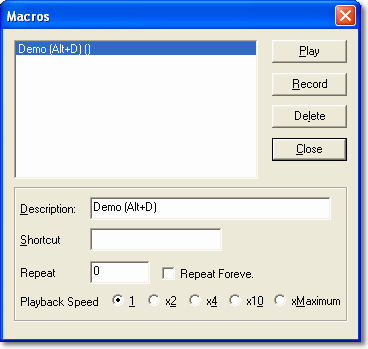
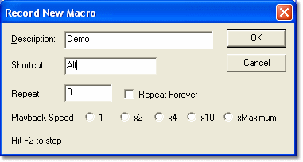

# Macros

System Monitor includes a facility to record keystrokes and to replay them as Macros. Macros are stored as `.mac` files (`macro0.mac`, `macro1.mac` and so on) in the folder set by the **Directory for configuration and macro files** [Advanced Setting](../../using-system-monitor/settings.md), and are available to all Projects.

!!! note
    Mouse movements and clicks are not recorded.

To open the **Macros** dialog box, select **Tools** > **Macros** (CTRL+M).

## Record a new macro

1. Click **Record** to open the **Record New Macro** dialog box.

    

2. Enter a **Description**.
3. Enter a **Shortcut Key** sequence. The shortcut consists of one or more control keys (CTRL, ALT or SHIFT) and a function key or any letter or number. If the keys are already used by another macro or by a hot-key, you are asked to choose another combination.
4. In **Repeat**, enter the number of times you want the macro to repeat on playback. The default is 0. Select **Repeat Forever** if you want the macro to continue to repeat until you stop it.
5. Select the **Playback Speed**: **1**, **x2**, **x4**, **x10** or **xMaximum**. The default is 1.
6. Click **OK**. The dialog boxes close and all keystrokes are recorded until you press **F2**.

## Edit, delete and play macros

The **Description**, **Shortcut key**, **Repeat** and **Playback Speed** of the macro selected in the list can be edited in the **Macros** dialog box.

To delete a macro, select it in the list and click **Delete**.

- To play a macro, select it in the list and click **Play**. Alternatively, press its shortcut key sequence; shortcut keys only work while the **Macros** dialog box is closed.
- To stop a macro that is playing, press CTRL+ESC.

**See also:** [Productivity Tools](index.md)
