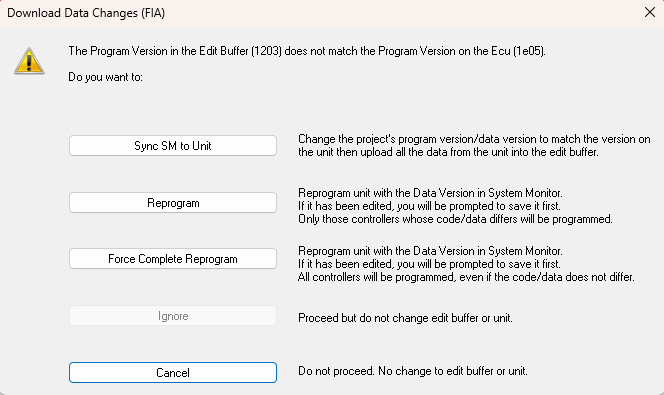

# Downloading Data to the ECU

The **Download Data Changes** command finds the differences between the data in the Edit Buffer and the ECU RAM, and loads them into RAM so that the RAM matches the Edit Buffer. See [Data Changes in the ECU](index.md).

The command only acts on the [Active Applications](../../project-management/active-application.md). The ECU is taken off-line during the download and returned to its previous state afterwards.

## Download data changes

Select **ECU** > **Download Data Changes** (F7).

If the Program Version or the Data Version in the Edit Buffer does not match the one in the ECU, the following message is displayed:

| Button | Action |
|---|---|
| **Sync SM to Unit** | Changes the project's Program Version / Data Version to match the unit, then uploads all the data from the unit into the Edit Buffer. If a file cannot be found, a new file is created using the filename and modification information taken from the unit. |
| **Reprogram** | Reprograms the unit with the Data Version in System Monitor (you are prompted to save it first if it has been edited). Only the controllers whose code or data differs are programmed. The changes in the Edit Buffer are then downloaded. |
| **Force Complete Reprogram** | As **Reprogram**, but all controllers are programmed even if their code or data does not differ. |
| **Ignore** | Not available for this command. |
| **Cancel** | Closes the message. No change is made to the Edit Buffer or the unit. |

If the versions match but the unit contains data that System Monitor did not put there (for example live tunes made elsewhere), a second message offers **Upload Data** (upload all the data from the unit into the Edit Buffer), **Download Data Changes** (download the whole Edit Buffer; live tunes in the unit may be lost) or **Cancel**.

If you have edited parameters that cannot be live tuned, you are asked to reprogram the unit or restore those values first.

**See also:** [ECU Control](../index.md); [Edit Buffer](../../project-management/developing-data-versions/index.md); [Live Tune](../../tuning/live-tune.md); [Tuning](../../tuning/index.md)
