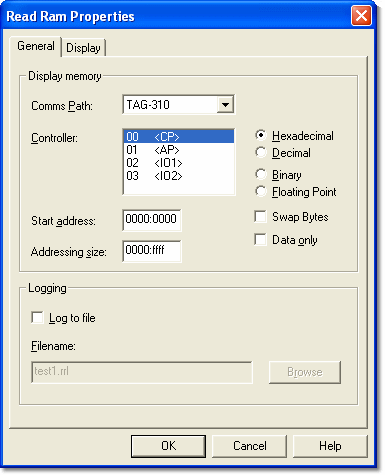

# Read RAM Properties - General

The General tab of the Read Ram Properties dialog box sets the source and format of the data in a [Read RAM window](read-ram.md).

## Display memory panel

| Control | Description |
|---|---|
| **Comms Path** | The comms path of the unit. Only needed if more than one unit is connected (see [Unit Definition](../../project-management/projects/creating-a-project/car-definition.md)). |
| **Controller** | The controllers in the connected ECU. Select the controller whose RAM you want to display. The [Memory Layout](../../project-management/projects/properties/application-properties/application-properties-memory-layout.md) tab of the Application Properties dialog box shows which controllers and memory locations an [Application](../../project-management/applications.md) uses; the [Controllers](../ecu-properties/ecu-properties-controllers.md) tab of the ECU Properties dialog box lets you view and enable/disable controllers. |
| **Hexadecimal** / **Decimal** / **Binary** / **Floating Point** | The format of the displayed data: 4, 5, 16 or 14 characters per value respectively. Hexadecimal is the default. Memory addresses are always shown in hexadecimal. |
| **Swap Bytes** | When selected, each word is shown with its byte order reversed. |
| **Data only** | When selected, the address column is not shown. |
| **Start address** | The address at which the display starts, entered as two 4-digit hexadecimal words separated by a colon (for example `0000:1111`). It should be on a word boundary (an even address). |
| **Addressing size** | The start address of the last block of data to be displayed, in the same format. |

## Logging panel

| Control | Description |
|---|---|
| **Log to file** | When selected, the RAM contents are logged to a file, updated at the same rate as the display. The display update rate is set in the [Display](../../using-system-monitor/windows/using-windows/window-properties-display-tab.md) tab. An indicator on the Read RAM window shows when logging is taking place. Cleared by default. |
| **Filename** / **Browse** | The file to which the RAM contents are logged (`.rrl`). The default name is `test1.rrl`. There is no default path; the most recently used path is used. |

**See also:** [Read Ram](read-ram.md); [Window Properties](../../using-system-monitor/windows/using-windows/window-properties.md); [Window Properties - Display tab](../../using-system-monitor/windows/using-windows/window-properties-display-tab.md)
