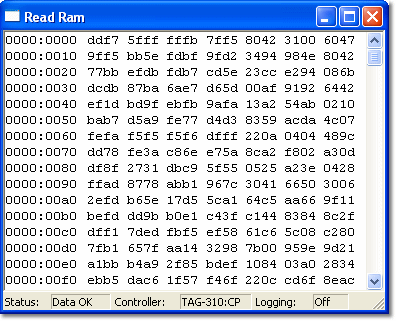

# Read Ram

The Read RAM window displays the contents of the [Random Access Memory](index.md) of a controller in the attached ECU. To open a Read RAM window, select **Tools** > **Read RAM** (Alt+R). Any number of Read RAM windows can be open on the same Desktop.

## Properties

The content and layout of the Read RAM window are set in the Read Ram Properties dialog box. To open it, select **Window Properties** from the [Window System Menu](../../using-system-monitor/menus/window-system-menu.md) (Alt+Enter). There are two tabs:

- [General](read-ram-properties-general.md) - specific to Read RAM windows; selects the source and format of the data.
- [Display](../../using-system-monitor/windows/using-windows/window-properties-display-tab.md) - controls the appearance of the window; common to all windows.

## Status bar

The status bar shows information about the controller and its connection to System Monitor.

**Status** - The state of the connection to the ECU:

- **Data OK** - The ECU is sending the data as requested.
- **Time Out** - The last request for data did not get a response.
- **No Data** - No data is being received.
- **Locked** - The requested memory could not be read because it is locked.

**Controller** - The controller name set in the Read Ram Properties dialog box.

**Logging** - Whether data is being logged to a file (**On** / **Off**), as set in the Read Ram Properties dialog box.

## Features

- The first column shows the address of the first word in the row. It can be hidden by selecting **Data only** in the Read Ram Properties dialog box.
- The contents can be displayed in hexadecimal, decimal, binary or floating point format.
- If the ECU is not On-Line when the window is opened, the memory contents are unknown and `?` characters are shown instead of values. If the ECU is taken Off-line, the last set of data is kept in the window.
- The contents of the window can be copied to the clipboard as ASCII text using the Edit Context menu. They can also be logged to a file by selecting **Log to file** in the Read Ram Properties dialog box.
- The [Memory Layout](../../project-management/projects/properties/application-properties/application-properties-memory-layout.md) tab of the Application Properties dialog box shows which controllers and memory locations an Application uses.
- As the window is resized, the number of memory locations and columns shown changes to fill the space.
- Interpreting the data is beyond the scope of this Help. For further assistance, contact [Motion Applied](../../technical-support/motion-applied.md).

**See also:** [Diagnostics](../../developer-functions/diagnostics.md); [ECU Memory](index.md)
