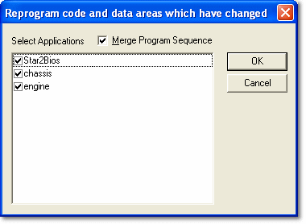
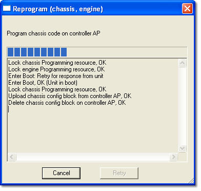

# Reprogramming the ECU

The ROM in the ECU contains the following:

- **Program** - The programs for all the controllers in the ECU, created from the Program Version file for the project. Controls in the Customer Base ensure that the Program Version in the project is suitable for the ECU.
- **Data** - The values of all the Editable Parameters, held in a Data Version file. A system is tuned by loading different Data Versions. See [Live Tune](../../tuning/live-tune.md).
- **Configurations** - System Monitor can set up these configurations in the ECU:
    - [Remote Logging](../../data-acquisition/logging/remote-logging/index.md)
    - [Burst Logging](../../data-acquisition/logging/burst-logging/index.md)
    - [Sensors & Actuators Calibration](../../data-acquisition/sensors/sensors-and-actuators/index.md)
    - [External Inputs](../../data-acquisition/sensors/external-inputs/external-inputs-configuration.md)

## Reprogram the ECU

1. Select **ECU** > **Reprogram Unit** (Alt+P). The Select Applications dialog box opens (see [Selecting Applications](../selecting-applications.md)). The command is only available if the Customer Base permits it (**Permit reprogramming** in [Customer Base Advanced Settings](../../project-management/customer-bases/customer-base-advanced-settings.md)).

    

2. Select the Applications to reprogram and, if required, **Merge Program Sequence**.

    !!! note
        When programming selected Applications you can choose to merge their programming sequences. When programming sensor sets that cover more than one Application, the sequences are always merged.

3. Click **OK**. The contents of the ROM are compared with the currently open project and every item that has changed is downloaded. A window reports progress.

    

    !!! warning
        Clicking **Cancel** stops the reprogramming. It does not reset any item that has already been reprogrammed, so the programs in the ECU may be inconsistent and it may not work properly. If the reprogram sequence is not allowed to finish, proper function of the ECU cannot be guaranteed.

4. When reprogramming is complete, **Cancel** changes to **Close**. Click **Close** to continue.

Live Updates is switched off and the ECU is taken off-line while reprogramming; both are restored afterwards. If the unit is in boot, you may be asked whether to force a complete reprogram instead.

**ECU** > **Reprogram All** (Ctrl+Alt+P) reprograms all code and data areas for all Applications, without the Select Applications dialog box, and then downloads the Remote logging configuration. You are asked to confirm, and warned if no logging configuration is open.

## Features

- To be programmed, the ECU controllers are placed in Boot mode (also known as Zone 0). If reprogramming is successful, they leave Boot mode automatically.
- Logging configurations and other data that does not directly affect the operation of the vehicle can be programmed at a different level, called Zone 1, during which some ECU functions can continue.
- The status of the controllers is shown on the Comms Bar.
- [Force Complete Reprogram](force-complete-reprogram.md) downloads all the program code, data and configurations, whether or not they have changed.
- To transfer information to a different unit, see [Spare Unit](../../project-management/projects/creating-a-project/spare-car.md).
- To update the Data Version only, see [Data Changes in the ECU](../data-changes-in-the-ecu/index.md).

**See also:** [ECU Control](../index.md); [ECU Bar](../../using-system-monitor/tool-and-information-bars/ecu-bar.md); [Unit Status](../unit-status.md); [Force Complete Reprogram](force-complete-reprogram.md); [Data Changes in the ECU](../data-changes-in-the-ecu/index.md); [Logging](../../data-acquisition/logging/index.md); [Loading Configurations](../../data-acquisition/logging/loading-configurations.md)
