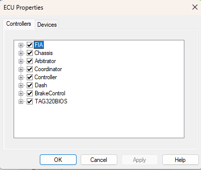

# ECU Properties - Controllers

The Controllers tab of the ECU Properties dialog box lets you view the controllers within the ECU and enable or disable them. See [Program and Data Versions](../../project-management/program-and-data-versions/index.md) for more information about controllers.

All the Applications are shown in a list. Click the expand icon  to see the controllers used by an Application. The check box beside each controller shows its status:

- **Selected** - The controller is connected to the Application and responds to reprogramming, tuning and monitoring.
- **Cleared** - The controller is disconnected from the Application and does not respond.

Select or clear the check box of an Application to connect or disconnect all its controllers. If an Application is connected to some, but not all, of its controllers, its check box is greyed.

Click **OK** or **Apply** to save the changes in the project.

**See also:** [ECU Properties](index.md); [Application Properties - Memory Layout](../../project-management/projects/properties/application-properties/application-properties-memory-layout.md); [Read Ram](../ecu-memory/read-ram.md)
