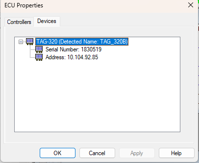

# ECU Properties – Devices

The Devices tab of the ECU Properties dialog box displays information about the ECU hardware.

Each unit is shown in the following format:

*aaaaa* (Detected Name: *bbbbb*)

where *aaaaa* is the comms path name of the unit and *bbbbb* is the type of unit detected by interrogating it.

Each unit is expanded to show:

- **Serial Number** - The serial number of the unit, found by interrogating it, or **(not connected)**.
- **Address** - For an Ethernet connection, the IP address of the unit as defined in [Unit Definition](../../project-management/projects/creating-a-project/car-definition.md). For other connections, the type of connection.

**See also:** [ECU Properties](index.md)
