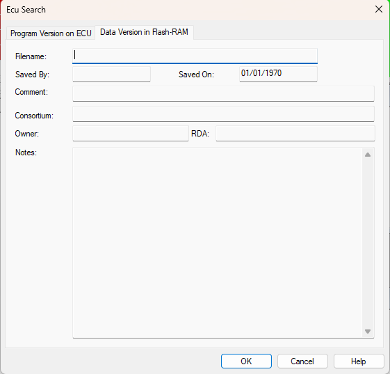

# ECU Search - Data Version

The **Data Version in Flash-RAM** tab of the Ecu Search dialog box shows the **Filename**, **Saved By**, **Saved On**, **Comment**, **Consortium**, **Owner**, **RDA** and **Notes** information for the Data Version in the ECU ROM.

All the information on this tab is read only.

**See also:** [ECU Memory](../ecu-memory/index.md); [ECU Search](index.md)
