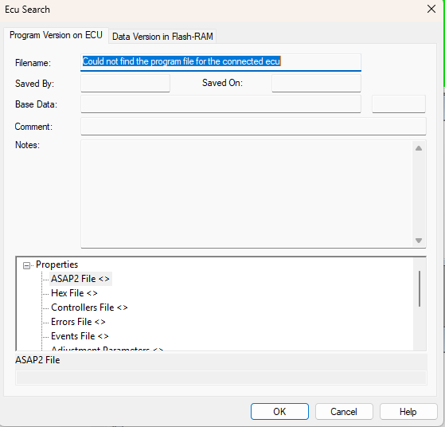

# ECU Search - Program Version

The **Program Version on ECU** tab of the Ecu Search dialog box shows the **Filename**, **Saved By**, **Saved On**, **Comment** and **Notes** information for the Program Version in the ECU. The files used to create the Program Version (ASAP2 file, Hex file, Controllers file and so on) are shown in the **Properties** list. The file name of the original Data Version, generated when the Program Version was created, is shown as **Base Data**.

If the file cannot be found, **Filename** shows "Could not find the program file for the connected ecu".

All the information on this tab is read only.

**See also:** [ECU Search](index.md); [Program Version](../../project-management/program-and-data-versions/index.md)
