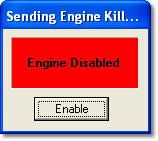

# Kill Engine

The Kill Engine command stops the engine or prevents it from starting. Select **Tools** > **Kill Engine** (Alt+K).

While Kill Engine is active, System Monitor sends engine kill messages to the ECU. The **Sending Engine Kill...** message box is displayed and the rest of the System Monitor user interface is disabled; measurement windows, events and so on still update.

The engine kill message (command 0x1A, which switches off ignition and injection for 2 seconds) is sent every 200 ms. The message box shows **Engine Disabled** on a red background while the ECU acknowledges the messages, and **Engine Enabled** on a yellow background when it does not.

The message is sent to the controller named by the system constant `ENGINE_KILL_CONTROLLER`:

- If the BIOS defines the constant, that controller is used.
- Otherwise the application that defines it is used. Define it in only one application: if more than one application defines it, no engine kill message is sent.
- If no application defines the constant, or the controller is disabled, no engine kill message is sent.

To close Kill Engine and allow the engine to start, click **Enable**, or press ENTER or ESC.

**See also:** [ECU Control](index.md)
