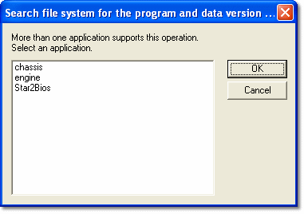
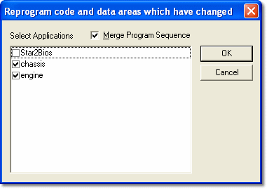

# Selecting Applications

An Application in System Monitor corresponds to a set of ECU memory locations. Most ECU Control commands operate on the [Active Applications](../project-management/active-application.md).

## Select an Application

[Setting Time and Date](setting-time-and-date.md) and [ECU Search](ecu-search/index.md) operate on one Application at a time. If more than one Application supports the command, a dialog box opens: select one Application and click **OK**. If only one Application supports it, that Application is used without asking.

## Select Applications

[Reprogramming the ECU](ecu-memory/reprogramming-the-ecu.md), [Force Complete Reprogram](ecu-memory/force-complete-reprogram.md) and [Program Spare Unit](../project-management/projects/creating-a-project/spare-car.md) can operate on more than one Application. The **Select Applications** dialog box opens:

1. Select the check boxes of the Applications to program (**Select All** and **Deselect All** are provided). By default the Active Applications are selected.
2. Select **Merge Program Sequence** if required.
3. Click **OK**.

An Application's check box is disabled if the Application is Read Only or its Customer Base does not permit reprogramming. An Application is marked **- Invalid PUL** and cannot be selected if its unlock list is invalid. An Application locked with enhanced RDA is marked **(!)** and cleared by default when the connection to the unit is not encrypted.

**See also:** [Active Application](../project-management/active-application.md); [ECU Control](index.md); [Setting Time and Date](setting-time-and-date.md); [ECU Memory](ecu-memory/index.md); [ECU Search](ecu-search/index.md)
