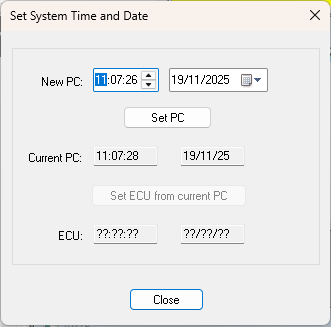

# Setting Time and Date

The ECU time and date are used to timestamp Events and logged data.

## Set the time and date

1. Select **ECU** > **Set System Time and Date** (F12).
2. If more than one Application has a clock controller, the Select an Application dialog box opens. Select an Application and click **OK**.
3. Use the **Set System Time and Date** dialog box:

| Control | Description |
|---|---|
| **New PC** | Enter a new time and date for the PC. A calendar is provided for the date. |
| **Set PC** | Sets the PC time and date to the values in **New PC**. |
| **Current PC** | Read only. The time and date of the PC. |
| **Set ECU from current PC** | Sets the ECU time and date to the **Current PC** values. |
| **ECU** | Read only. The time and date of the ECU. |
| **Close** | Closes the dialog box. |

**See also:** [ECU Control](index.md); [Events](../data-display/other-displays/events/index.md); [Logged Data](../data-acquisition/logging/index.md); [Selecting Applications](selecting-applications.md)
