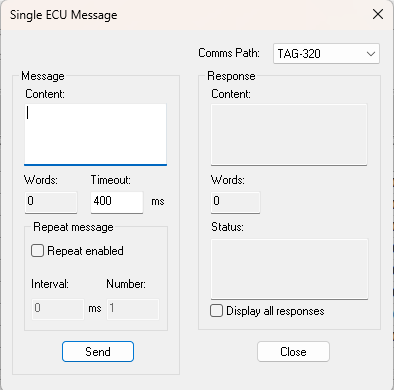

# Single Message

The Single ECU Message dialog box sends a single message to the ECU and displays the response. To open it, select **Tools** > **Single Message...** (Alt+M).

**Comms Path** - Select the comms path of the unit to send to. This is only needed if more than one unit is connected (see [Unit Definition](../project-management/projects/creating-a-project/car-definition.md)).

## Message panel

| Control | Description |
|---|---|
| **Content** | The message to send, as a sequence of word-length hexadecimal values. Only valid hexadecimal values are accepted. |
| **Words** | Read only. The number of words in the message. |
| **Timeout** | The time to wait for a response, in ms (0 to 60000; default 400). |
| **Send** | Sends the message. |

## Repeat message panel

| Control | Description |
|---|---|
| **Repeat enabled** | When selected, the message is sent repeatedly when **Send** is clicked, according to **Interval** and **Number**. |
| **Interval** | The time between repetitions, in ms (0 to 60000). Only available when **Repeat enabled** is selected. |
| **Number** | The number of times the message is sent (1 to 999999). Only available when **Repeat enabled** is selected. |

## Response panel

| Control | Description |
|---|---|
| **Content** | Read only. The response from the ECU, in hexadecimal. |
| **Words** | Read only. The number of words in the response. |
| **Status** | Read only. The status of the response: the response status text from the ECU (for example **Response Back OK**), **Response Timeout** if no response was received, or **No Comms** if there is no communication with the unit. |
| **Display all responses** | When selected, all response messages are displayed. When cleared, only responses intended for System Monitor are displayed. |

!!! note
    The same dialog box is used to set up a Single Message action from a Numeric Grid window. It then also has a **Button Text** box, **Repeat enabled** is not available, and the **Send** and **Close** buttons become **Test** and **Save**.

**See also:** [Diagnostics](../developer-functions/diagnostics.md); [ECU Control](index.md)
