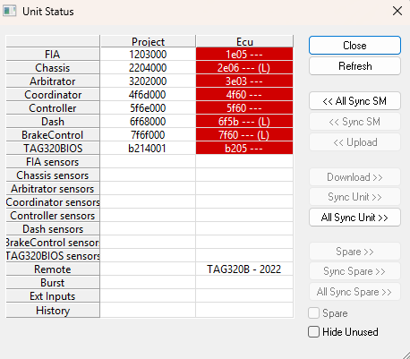

# Unit Status

The Unit Status dialog box shows which files are loaded in the Edit Buffer and in the unit, and is used to synchronise the two. The dialog box can be resized and the column widths can be changed.

To open the dialog box, select **Tools** > **Unit Status** (Ctrl+U). To select more than one cell, use the SHIFT and CTRL keys.

## Columns

| Column | Description |
|---|---|
| **Project** | The files currently loaded into System Monitor. |
| **Ecu** | The files currently loaded into the main unit. |
| **Spare** | The files currently loaded into the spare unit. Only shown when the **Spare** check box is selected. |

## Rows

| Row | Description |
|---|---|
| Data Versions | One row for each Application. See [Developing Data Versions](../project-management/developing-data-versions/index.md). |
| *Application* sensors | The Sensor Set for each Application. See [Sensors & Actuators](../data-acquisition/sensors/sensors-and-actuators/index.md). |
| Remote, Burst, Ext Inputs | The Remote logging, Burst logging and External Inputs configurations, which the unit uses when it is working independently of System Monitor. See [Loading Configurations](../data-acquisition/logging/loading-configurations.md). |
| History | The History Report configuration. See [History Report](../history-report/index.md). |

When **Hide Unused** is selected, the rows for configuration types that are not open in the project are hidden.

## Cell colours

| Colour | Meaning |
|---|---|
| White | The unit contains the same information as System Monitor. |
| Red | The unit contains a different program or data version (or different live tunes) from System Monitor. In the **Project** column, red marks an Application whose Program Version does not match the main BIOS. |
| Blue | The unit contains a different configuration (sensor set, remote logging, burst logging, external inputs, history report), or the configuration could not be read. |
| Yellow | Selected cell. A summary of the file history for the selected cell is shown at the bottom of the dialog box. |

## Other symbols

| Symbol | Meaning |
|---|---|
| `(*)` | The data has been modified and not yet saved. |
| `?` | System Monitor cannot obtain the information from the unit. |
| `(L)` | The Data Version is locked with standard RDA. |
| `(L2)` | The Data Version is locked with enhanced RDA (RDA 2). |

## Controls

With a cell or cells selected, the following commands are available:

| Button | Action |
|---|---|
| **Refresh** | Updates the display. |
| **<< All Sync SM** | Synchronises System Monitor to all files in the Ecu or Spare column. The same as selecting all cells in that column and clicking **<< Sync SM**. |
| **<< Sync SM** | Synchronises System Monitor to the files for the selected cells in the Ecu or Spare column. The files are opened in System Monitor, replacing those already open. If a file cannot be found, a new file is created using the filename and modification information from the unit. Data is uploaded into the Edit Buffer; files and data that are the same as in System Monitor are not uploaded. |
| **<< Upload** | Uploads the information for the selected cells in the Ecu or Spare column into the Edit Buffer. If the Program or Data Versions are different, the upload is aborted. |
| **Download >>** | Downloads the information for the selected cells in the Project column to the main unit. For Data Versions, runs [Force Complete Reprogram](ecu-memory/force-complete-reprogram.md) before downloading data. |
| **Sync Unit >>** | Synchronises the main unit with the Edit Buffer for the selected cells in the Project column. If the Program or Data Versions are different, runs [Reprogram Unit](ecu-memory/reprogramming-the-ecu.md) then [Download Data Changes](data-changes-in-the-ecu/downloading-data-to-the-ecu.md). Configuration files that are the same as in System Monitor are not downloaded. |
| **All Sync Unit >>** | Synchronises all files in the main unit with the Edit Buffer. The same as selecting all cells in the Project column and clicking **Sync Unit >>**. |
| **Spare >>** | As **Download >>**, but sends the information to the spare unit. Only available when the Spare column is shown. |
| **Sync Spare >>** | As **Sync Unit >>**, but for the spare unit. Only available when the Spare column is shown. |
| **All Sync Spare >>** | As **All Sync Unit >>**, but for the spare unit. |
| **Spare** | Shows the Spare column. Only available if a [Spare Unit](../project-management/projects/creating-a-project/spare-car.md) has been configured. |
| **Hide Unused** | Hides rows for configuration types that are not in use. |
| **Close** | Closes the dialog box. |

The **Tools** menu also has **Sync SM to Unit**, **Sync Unit to SM** and **Sync Spare Unit to SM**, which do the same as the All Sync buttons without opening the dialog box.

**See also:** [ECU Control](index.md); [Edit Buffer](../project-management/developing-data-versions/index.md)
