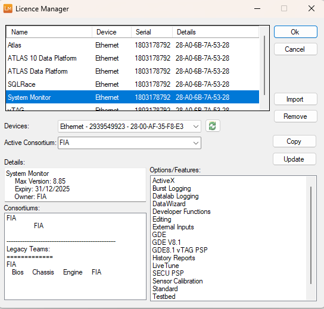

# Adding a Licence

System Monitor licences are added and removed in the Licence Manager.

To open the Licence Manager, select **Help** > **Licence Manager**, click **Add Licence** in the Licence Required dialog box, or select **Licence Manager** from the **McLaren Electronic Systems** folder in the Windows Start menu.

!!! note
    System Monitor does not use licence codes. A licence file is stored on the local machine, which defines the Teams, the Application access for each Team, and the other System Monitor options. Licences are requested and generated online on the [Motion Applied portal](https://portal.motionapplied.com/). See [Reduced Data Access](../team-security-and-reduced-data-access/reduced-data-access.md).

The list shows every licence that has been added, with its **Name** (product), **Device** type, **Serial** number and **Details**. The devices do not have to be connected to appear in the list. Select a licence to show its profile in the lower part of the dialog box.

| Control | Description |
|---|---|
| **Import** | Select the folder containing your licence files. System Monitor imports the `.lic` files that match the licence devices on this PC; if more than one file matches a product, you choose which to use. If no matching licence is found, you can browse for a licence file instead. |
| **Remove** | Remove the licence selected in the list. |
| **Devices** | The licence devices (dongles and network cards) currently detected on this PC, with their serial numbers. Click the refresh button next to the list to detect devices again. |
| **Copy** | Copy the list of detected devices to the clipboard, for example to include in a licence request. |
| **Update** | Request updated licences online: enter your e-mail address, click **Next** to get the list of products that can be licensed, select the products and click **Request**. |
| **Active Team** | Select the Active Team from the drop-down list. For consortium licences this is **Active Consortium**. An Active Team must be selected before you can click **Ok**. See [Team Security](../team-security-and-reduced-data-access/team-security.md). |
| **Details** | A summary of the selected licence, such as the maximum version, expiry date and owner. |
| **Teams** / **Consortiums** | The Teams in the selected licence. The Applications listed beneath a Team are those the Team has unrestricted access to. See [Reduced Data Access](../team-security-and-reduced-data-access/reduced-data-access.md). |
| **Options** | The System Monitor options (features) enabled by the selected licence. |

**See also:** [Licence Checking](licence-checking.md); [Licensing](index.md)
