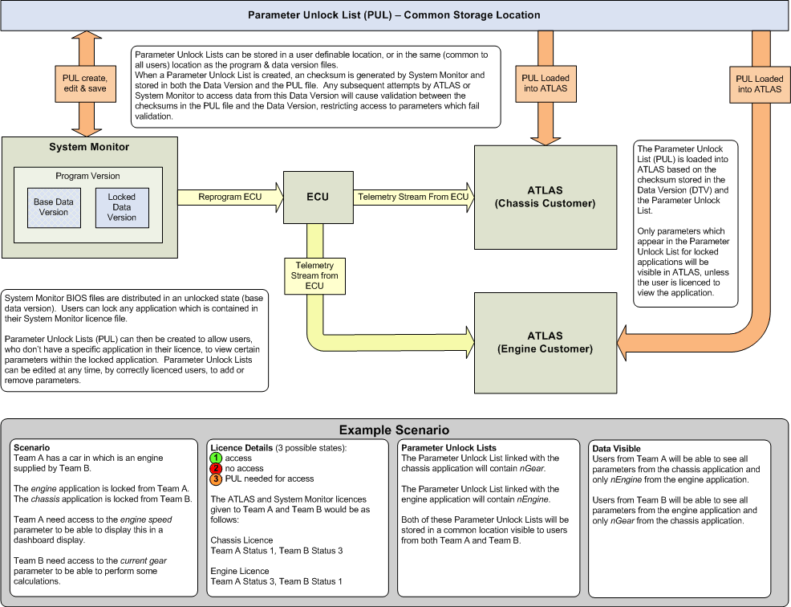
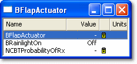

# Reduced Data Access

The Reduced Data Access (RDA) feature of System Monitor allows teams to restrict the sharing of data and set-ups between engine and chassis [Applications](../../project-management/applications.md). Access is defined by the team's licence, and has three states:

1. Full Access
2. No Access
3. Restricted Access

If a team's access to an Application is restricted, parameters within the Application are locked unless they are included on a [Parameter Unlock List](../../using-system-monitor/parameters/locked-parameters/about-the-parameter-unlock-list.md). Locked parameters are still stored in the session data, so users with full access to the Application can still view them. Teams with restricted access cannot add a locked parameter to the Desktop, or view or edit its properties.

## Licensing

Access to data is controlled by the licence management scheme. Each licence is a licence file held on the local machine. Application qualifiers in the licence file determine which Applications a team has [Full Access](#full-access) to and which it has [Restricted Access](#restricted-access) to. Teams can also be blocked from any access to an Application ([No Access](#no-access)), whether or not an unlock list is present; this is shown by the Application name being prefixed with *Locked:*.

### Full Access

All parameters in the Application are unlocked. The team can edit the Application's Parameter Unlock List.

### Restricted Access

Parameters in the Application are locked, except those on the Application's Parameter Unlock List.

### No Access

All parameters in the Application are locked, whether or not an unlock list is present.

!!! note
    New licences are requested and generated online on the [Motion Applied portal](https://portal.motionapplied.com/). Authorised users can request System Monitor and ATLAS licences and select a licence profile. Licence profiles define the teams associated with the licence, access to the Applications, and other options such as ActiveX. The online process generates the licence file. See [Adding a Licence](../licensing/adding-a-licence.md).

## Parameter Unlock List (PUL)

Each Application has an associated Parameter Unlock List (PUL), which lists the parameters that are accessible to a team with Restricted Access. A team with restricted access to an Application can therefore still access specific parameters in it, if they are on the PUL.

Teams with full access to an Application can edit the PUL to add or remove parameters. Access to the PUL is provided by the **Unlock List Management** tab of the [Application Properties](../../project-management/projects/properties/application-properties/index.md) dialog box. Unlock list files are kept in `Documents\McLaren Electronic Systems\System Monitor 8\Unlock Lists` by default.

**See also:** [Edit the Parameter Unlock List](../../using-system-monitor/parameters/locked-parameters/edit-the-parameter-unlock-list.md); [About the Parameter Unlock List](../../using-system-monitor/parameters/locked-parameters/about-the-parameter-unlock-list.md)

## On loading a DTV

A checksum is calculated from the Parameter Unlock List and stored in the header of the Data Version (`.dtv`) file. When the DTV is loaded, this value is checked against the PUL:

- If the team is not authorised for full access to an Application:
    - If the checksum matches, the appropriate parameters are unlocked.
    - If the checksum does not match, you are prompted to find an alternative PUL.
    - If no PUL file is found, all parameters for that Application remain locked.
- If the team is authorised for full access, no checks are made and all parameters are unlocked.

When a Data Version is saved with **File** > **Save As**, the File Save As dialog box may also show a **Disable RDA** check box, which saves the Data Version without Reduced Data Access. It is only shown when RDA is set on the Data Version and your licence allows you to change it.

## Locked parameters

Teams with restricted access to an Application see parameter icons with a lock symbol superimposed. For example, a locked Measurement Parameter looks like this in the Explorer: 

To filter the Explorer, use **View** > **Display Unlocked Parameters Only**, **Display Locked Parameters Only** or **Display All Parameters**.

Locked parameters are not removed from display windows that they were previously added to; their values are hidden. In a display window, a lock icon  is shown in the status column and `-` in the value column.

**See also:** [Locked Parameters](../../using-system-monitor/parameters/locked-parameters/locked-parameters.md); [Windows](../../using-system-monitor/windows/index.md); [Team Security](team-security.md)
