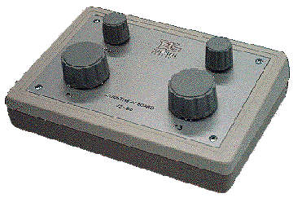

# Adjustment Board

The Adjustment Board is a box with four high-precision rotary switches. System Monitor can logically connect each control (in each of two switch positions) to a Scalar Editable Parameter that can be live tuned. This allows changes to be made to the control system using the tactile response of the switches, while focusing on the readings displayed in System Monitor and on other instruments at the test bed.

The controls all work in the same way; the knobs are different sizes so that they can be located more easily. Turning a control clockwise increases the value of the parameter assigned to it. Turning it anti-clockwise decreases the value.

To assign parameters to the controls, see [Adjustment Board Configuration](../tuning/adjustment-board-control/adjustment-board-configuration.md). The ECU must be online, with live updates enabled, before parameters can be adjusted with the Adjustment Board.

The connection to the Adjustment Board is set in the **Link** group of the [Pot Board Properties](../tuning/adjustment-board-control/pot-board-properties.md): select **CA Card** or **Serial Port**.

The following types of Adjustment Board are available:

- **VE-80** - The VE-80 is passive and uses dedicated connections on the [CA-Card](communication-adaptor-ca-card.md). The connection details are given in the product specification for the CA-Card. There is no separate power supply. To use a VE-80, select **CA Card** in the Pot Board Properties.
- **VE-81** - The VE-81 is active and is connected through a serial port. Connect the VE-81 to an RS-232 serial port on the PC running System Monitor using the cable provided. Connect the power supply provided to the socket at the back of the VE-81 and to a suitable AC supply. The LED on the back of the VE-81 flashes once per second to show that the unit is live and transmitting. To use a VE-81, select **Serial Port** in the Pot Board Properties and select the COM port that the VE-81 is connected to. The list shows the COM ports available on the PC.
- **VE-82** - The drivers for the VE-82 Pot Board are provided with System Monitor (the **VE-82 Drivers** component). See [Custom Installation](../getting-started/custom-installation.md).

!!! note
    The Adjustment Board is commonly called a **Pot** or **Potentiometer** Board. This is not strictly accurate: a potentiometer gives a fixed output for a given position, whereas the rotary switches on the Adjustment Board give a pulse train and a direction. The position of a switch on the Adjustment Board has no absolute value.

**See also:** [Adjustment Board Control](../tuning/adjustment-board-control/adjustment-board-control.md); [Scalar Editable Parameter](../tuning/scalar-window.md)
