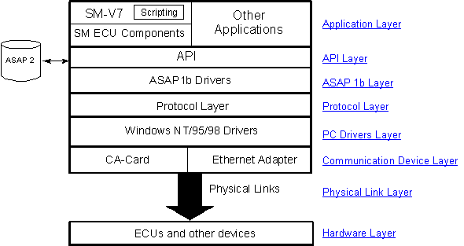

# Communication Architecture - Layers

The Communication Architecture consists of the following layers:

## Application layer

The application, such as System Monitor or [ATLAS](../technical-support/atlas.md), uses this layer.

In System Monitor, an additional layer provides a graphical user interface for ECUs. This layer implements an *ECU Component* for each group of ECUs supported.

## API layer

The API allows the application to interface with the architecture.

It is a set of classes that provides a standard interface for talking to any connected device, using the ASAP standard of communication with hardware through ASAP1b drivers.

The API supports functions such as the **SendMessage** and **ReadMemory** commands, download and upload of program and data, data acquisition, and row data. See [ActiveX Automation](../activex-automation/index.md).

## ASAP1b driver layer

The ASAP1b interface provides a standard means of communication with devices. ASAP1b is part of the ASAP standards, and requires information from ASAP2 data that is provided by the application.

## Protocol layer

This layer implements the individual protocols used to talk to connected devices, such as the TAG protocol. It also provides functions for the CA-Card itself and for peripheral devices connected to it.

Each application creates its own instance of the API and ASAP1b layers, and the protocol layer manages sessions between threads and devices.

The protocols supported in this layer are:

- **TAG proprietary protocol** - Supports communication through the CA-Card PC drivers, the operating system TCP/IP protocol stack (for communication over Ethernet), or a CAN interface.
- **CA-Card protocol** - For communication with, and control of, the CA-Card.
- **Pot Board, digital and analogue input, and CAN bus protocols** - Each peripheral connection to the CA-Card is supported through its own protocol.

## PC drivers layer

Contains the drivers installed on the user's PC to support the CA-Card, the Ethernet adapter or the CAN interface. The Ethernet adapter drivers are supplied by the manufacturer of the adapter or are part of the operating system.

## Communication device layer

Supports a CA-Card (CA-125 or CA-126), an Ethernet adapter, a PCMCIA HDLC card, or a CAN interface (Vector CAN card or PEAK-System PCAN-USB).

## Physical link layer

Communication with devices takes place through this medium. The physical connections are:

- Connections on the CA-Card:
    - HDLC link (4 Mbit/s or 750 kbit/s)
    - digital and analogue input connections
    - CAN bus (for CAN monitoring)
    - Pot Board connection
    - K-Link, Serial Measurement Bus (RS-232) and TAG Sensor Bus (2 Mbit/s).
- Connections through the Ethernet adapter:
    - Ethernet link (local and wide area) to the ECU, using TCP/IP.
- Connections through a CAN interface:
    - CAN link to the ECU.

## Connected devices (hardware layer)

These are the devices connected to the system through the CA-Card, an Ethernet link or a CAN interface. The ECUs and devices supported directly are:

- TAG units
- Adjustment Board
- PCU devices connected directly to the CA-Card (a PCU connected to TAG units is supported through the normal TAG unit connection)
- digital and analogue input devices (such as sensors)
- serial sensors (through the Serial Measurement Bus).

**See also:** [Communication Architecture](communication-architecture.md); [Communication Adaptor (CA-Card)](communication-adaptor-ca-card.md); [ActiveX Automation](../activex-automation/index.md)
