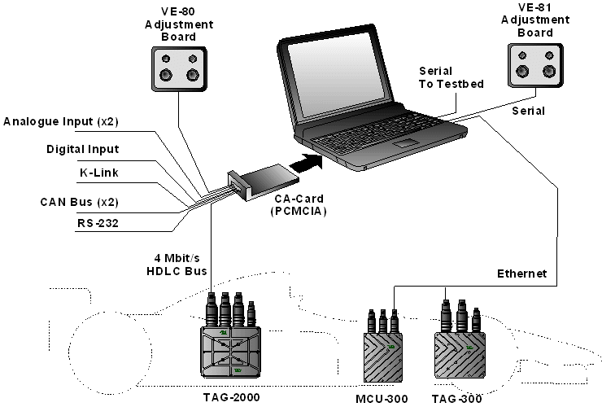

# Communication Architecture

The communications architecture is the mechanism by which System Monitor communicates with connected devices such as ECUs, sensors and the [Adjustment Board](adjustment-board.md).

The connection to an ECU is selected on the [Connections](../project-management/projects/properties/connections.md) tab of the Project Properties. The following link types are available:

- **HDLC via CA Card** - through a TAG [CA-Card](communication-adaptor-ca-card.md) (CA-125 or CA-126)
- **IP via Ethernet** - through an Ethernet link using TCP/IP (as used in the TAG-300/MCU-300 system); select the network adapter to use
- **HDLC via PCMCIA card**
- **CAN via VECTOR card** - through a Vector CAN interface; select the baud rate
- **PCAN-USB** - through a PEAK-System PCAN-USB adapter; select the baud rate.

The diagram shows how devices can be connected to a PC running System Monitor through a CA-Card or Ethernet.

If more than one application tries to communicate with the same device through the same port of a CA-Card, the CA-Card allows only one application session with that device at a time.

One or more applications can talk to multiple devices through different ports on the CA-Card at the same time.

Over TCP/IP (for example, over Ethernet), multiple applications are supported.

Only one CA-Card can be used in a PC.

**See also:** [Communication Architecture - Layers](communication-architecture-layers.md); [Communication Adaptor (CA-Card)](communication-adaptor-ca-card.md); [ActiveX Automation](../activex-automation/index.md)
