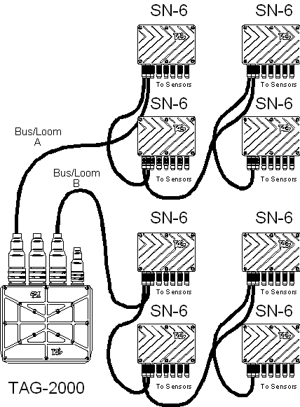

# Sensor Bus

The TAG **Sensor Bus** is the communication link in the DATA*Lab* system.

DATA*Lab* allows certain TAG [Data Logging](../data-acquisition/logging/index.md) devices (a combined chassis and engine control unit, or the DLU dedicated Data Logging Unit) to gather data from data acquisition units (Sensor Nodes) such as the [SN-6](sensor-node-sn-6.md) or [SN-32](sensor-node-sn-32.md).

The **TAG-300**, **MCU-300** and **MCU-300DA** each have three Sensor Bus looms.

Before it can be used, a DATA*Lab* system must be configured to recognise the sensors connected to it. Use the [External Inputs Configuration](../data-acquisition/sensors/external-inputs/external-inputs-configuration.md) tool to do this.

**See also:** [External Inputs Configuration](../data-acquisition/sensors/external-inputs/external-inputs-configuration.md); [Sensors](../data-acquisition/sensors/index.md)
