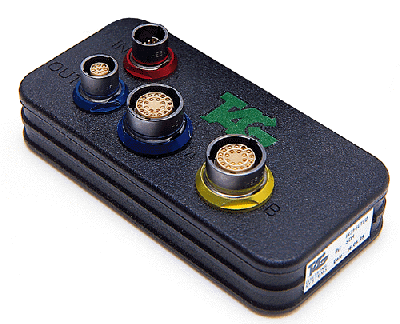

# Sensor Node SN-32

The SN-32 is a compact, lightweight data acquisition unit (Sensor Node) that accepts input from several sensors. Two versions are available: the standard type (shown in System Monitor as SN32-S) and the SN-32LT (shown as SN32-LT), a special type for use with lambda sensors.

The input configurations are:

| Input | SN-32 | SN-32LT |
|---|---|---|
| **Analogue 0 to 5 V, 12 bit, 1 kHz** | 9 | 5 |
| **Analogue 0 to 5 V, 10 bit, 1 kHz** | 6 | - |
| **Analogue 0 to 5 V, 10 bit, 125 Hz** | 7 | 3 |
| **Analogue 0 to 5 V, 10 bit, 125 Hz (can be configured for PT1000 temperature sensors)** | 4 | 4 |
| **DHE speed sensors** | 4 | 4 |
| **K type thermocouples** | 2 | 10 |
| **UEGO lambda sensors** | - | 6 |

Each [Sensor Bus](sensor-bus.md) loom can support one SN-32.

**See also:** [Sensor Bus](sensor-bus.md); [Sensor Node SN-6](sensor-node-sn-6.md)
