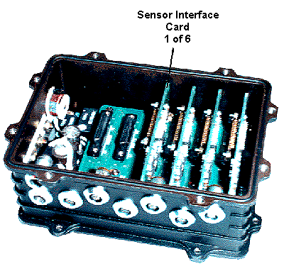

# Sensor Node SN-6

The SN-6 is a versatile data acquisition unit (Sensor Node) that can be configured to work with many different types of sensor by means of interchangeable Sensor Interface Cards (SICs). Up to six Sensor Interface Cards can be installed in an SN-6.

Each Sensor Interface Card can be connected to one or two sensors, depending on the type of card:

| Type of SIC | Number of inputs | Sensor type |
|---|---|---|
| **Resistive bridge** | 1 | Pressure - 5 wire |
| **5 V/Potentiometer** | 1 | Any 0 to 5 V |
| **Hall effect** | 2 | Speed |
| **Inductive** | 2 | Speed |
| **LVDT** | 1 | Position - AC coupled LVDT |
| **Pt1000** | 2 | Temperature - resistive |
| **Thermocouple** | 1 | Temperature - K type thermocouple |
| **Active filter** | 1 | Charge amplifier (applies a low-pass filter) |
| **Sample & hold** | 1 | Any 0 to 5 V |

The resistive bridge SIC can only be used in slots 1 to 4 of an SN-6. When it is used with a 5-wire pressure sensor, input 2 is reserved for the temperature output of the sensor (see [External Inputs - Adding a Sensor](../data-acquisition/sensors/external-inputs/external-inputs-adding-a-sensor.md)).

An interface card has no software-configurable items. To change the operation of a slot, insert a different interface card.

Up to four SN-6 units can be daisy-chained on each [Sensor Bus](sensor-bus.md) loom.

**See also:** [Sensor Bus](sensor-bus.md); [Sensor Node SN-32](sensor-node-sn-32.md)
