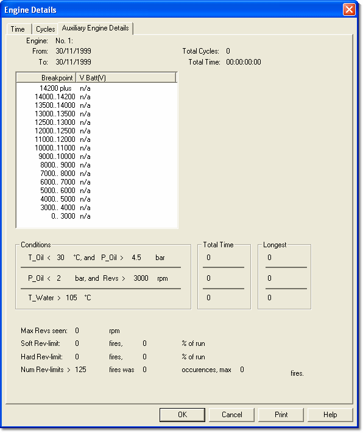

# Engine Details – Auxiliary

The **Auxiliary Engine Details** tab of the [Engine Details](history-report-engine-details.md) dialog box shows diagnostic data for the selected engine.

The tab displays read-only statistics for the selected engine:

| Field | Description |
|---|---|
| **Engine** | The number of the engine and the text from its row in the [History Report – Summary](history-report-summary.md). |
| **From** | The date and time from which the engine data has been collected (normally when it was last reset). |
| **To** | The date and time that the engine last ran, as recorded by the ECU. |
| **Total Cycles** | The number of cycles accumulated by the engine while history data was being recorded. |
| **Total Time** | The time accumulated by the engine while history data was being recorded. |

## Breakdown by engine speed

The list shows the following values for each rev breakpoint range (**Breakpoint** column). A value of **n/a** means that the engine did not run in that range.

| Column | Description |
|---|---|
| **V Batt(V)** | Battery voltage. |
| **I Alt(A)** | Alternator current. Shown only if the ECU records alternator data. |
| **NMisfire** | Number of misfires. Shown only if the ECU records misfire data. |
| **Misfire ppm** | Misfires in parts per million. Shown only if the ECU records misfire data. |

!!! note
    The breakpoint and condition values can be modified in the [Setup](history-report-setup.md) tab of the History Report dialog box.

## Conditions panel

The Conditions panel shows the **Total Time** and the **Longest** individual period that the engine was in the following states:

- Oil temperature (T_Oil) is lower than *condition* while oil pressure (P_Oil) is greater than *condition*
- Oil pressure (P_Oil) is lower than *condition* while engine speed (Revs) is greater than *condition*
- Water temperature (T_Water) is greater than *condition*

## Statistics

| Field | Description |
|---|---|
| **Max Revs seen** | The highest engine speed reached while the history data was being recorded. |
| **Soft Rev-limit** | The number of fires at the soft rev limit (engine speed high enough for the ECU to retard the ignition). Also shown as a percentage of the run. |
| **Hard Rev-limit** | The number of fires at the hard rev limit (engine speed high enough for the ECU to cut the ignition). Also shown as a percentage of the run. |
| **Num Rev-limits >** | The number of occurrences where the number of consecutive rev-limit fires exceeded *condition* (FiresInLimit). The maximum number of consecutive rev-limit fires is also shown. |

**See also:** [History Report - Summary](history-report-summary.md); [History Report - Setup](history-report-setup.md)
