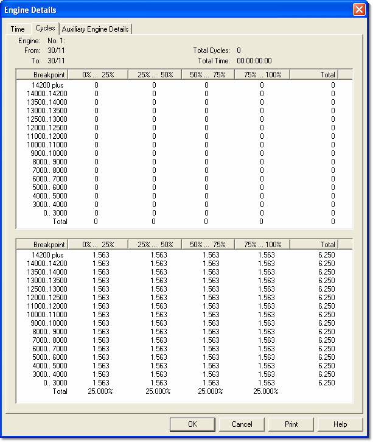

# Engine Details – Cycles

The **Cycles** tab of the [Engine Details](history-report-engine-details.md) dialog box shows a breakdown of the number of cycles during which the selected engine was in selected combinations of engine speed and throttle opening.

The tab displays read-only statistics for the selected engine:

| Field | Description |
|---|---|
| **Engine** | The number of the engine and the text from its row in the [History Report – Summary](history-report-summary.md). |
| **From** | The date and time from which the engine data has been collected (normally when it was last reset). |
| **To** | The date and time that the engine last ran, as recorded by the ECU. |
| **Total Cycles** | The number of cycles accumulated by the engine while history data was being recorded. |
| **Total Time** | The time accumulated by the engine while history data was being recorded. |

## Features

- The upper pane shows a breakdown of the number of cycles during which the selected engine was in each combination of engine speed (rows) and throttle opening (columns), with a **Total** column.
- The lower pane shows the same data as a percentage of the total number of cycles.
- The breakpoint values can be modified in the [Setup](history-report-setup.md) tab of the History Report dialog box.

**See also:** [History Report - Summary](history-report-summary.md); [History Report - Setup](history-report-setup.md)
