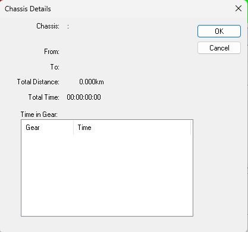

# History Report - Chassis Details

To open the Chassis Details dialog box for a chassis data set, select its row in the Chassis panel of the [History Report – Summary](history-report-summary.md) tab and press ENTER, or double-click it. The dialog box displays read-only statistics for the selected chassis.

| Field | Description |
|---|---|
| **Chassis** | The text from the row for that chassis in the History Report – Summary. |
| **From** | The date and time from which the chassis data has been collected (normally when it was last reset). |
| **To** | The date and time that the chassis last ran, as recorded by the ECU. |
| **Total Distance** | The distance accumulated by the chassis between the **From** and **To** dates. |
| **Total Time** | The time accumulated by the chassis while history data was being recorded. |
| **Time in Gear** | A breakdown of the time the chassis was in each gear. |

**See also:** [History Report - Summary](history-report-summary.md)
