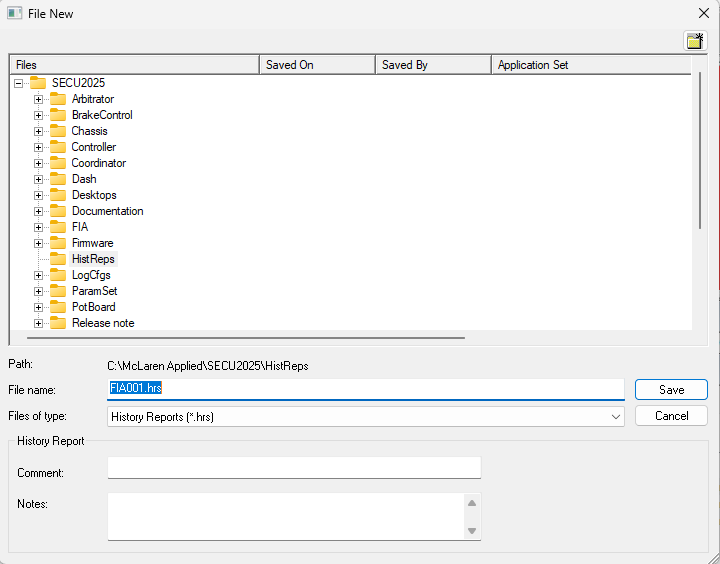

# History Report - Files

History Report files have the extension **.hrs** and are stored in the `HistReps` sub-folder of the [Multi-Application Base](../project-management/customer-bases/multi-application-base.md).

The default name for a History Report file is **XXXXXnnn.hrs**, where:

- **XXXXX** - the first five characters of the name of the application in the Project that supports History Report
- **nnn** - a three-digit hexadecimal number, one higher than the highest number already used in the folder for that name (the first file is 001)

The History Report file name is displayed in the title bar of the [History Report dialog box](history-report-dialog-box.md).

When **Tools** > **History Report** > **Upload** is selected and the Project has no History Report file, a new file is created with the next sequential number.

## Saving History Report files

If you make any changes to the history data, including uploading from the ECU, you are prompted to save the History Report file when you close the History Report dialog box. Use **File** > **Save As** if you want to save a History Report file under a different name.

**See also:** [History Report](index.md); [Multi-Application Base](../project-management/customer-bases/multi-application-base.md); [Project File](../project-management/files/types-of-files/project-files.md)
