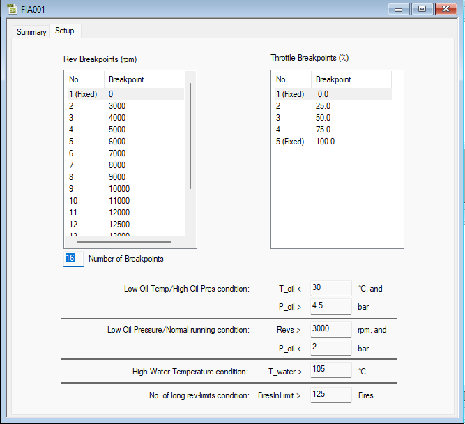

# History Report – Setup

The **Setup** tab of the [History Report dialog box](history-report-dialog-box.md) allows you to modify the way history data is collected.

## Rev Breakpoints (rpm)

Edit the breakpoints to modify the ranges of engine speed used to display statistics in the Chassis Details and Engine Details dialog boxes. The same set of breakpoints is used for all displays.

**Number of Breakpoints** can be set from 1 to 16 (16 breakpoints are available). Breakpoints above the number set are shown as "Unset" and cannot be edited.

All breakpoint values, except the first (marked **(Fixed)**), can be edited. Click the breakpoint value (or press F2) and enter the new value. Each breakpoint value must lie between its neighbouring values; otherwise the message "Breakpoint out of sequence" is shown.

## Throttle Breakpoints (%)

Edit the breakpoints to modify the ranges of throttle opening used to display statistics in the Engine Details dialog box. The same set of breakpoints is used for all displays.

The number of throttle breakpoints is fixed at 5.

Each breakpoint value, except the first and the last (marked **(Fixed)**), can be edited. Click the breakpoint value and enter the new value. Each breakpoint value must lie between its neighbouring values.

## Conditions

Edit the values used for the conditions in the [Auxiliary Engine Details](engine-details-auxiliary.md) tab.

| Condition | Meaning | Allowed range |
|---|---|---|
| **Low Oil Temp/High Oil Pres condition** | Oil temperature is lower than **T_oil** °C and oil pressure is greater than **P_oil** bar | T_oil: -40 to 287 °C; P_oil: 0 to 16 bar |
| **Low Oil Pressure/Normal running condition** | Engine speed is greater than **Revs** rpm and oil pressure is lower than **P_oil** bar | Revs: 0 to 30000 rpm; P_oil: 0 to 16 bar |
| **High Water Temperature condition** | Water temperature is greater than **T_water** °C | -40 to 287 °C |
| **No. of long rev-limits condition** | Counts the times that the number of consecutive rev-limit fires exceeds **FiresInLimit** | 0 to 60000 fires |

To send changes made on this tab to the ECU, select: **Tools** > **History Report** > **Download**.

!!! warning
    Changing the setup affects how engine statistics are collected. When you download a changed setup, System Monitor warns that all engine statistics will be reset. Click **OK** to reset them and continue, or **Cancel** to abort the download.

**See also:** [History Report dialog box](history-report-dialog-box.md)
