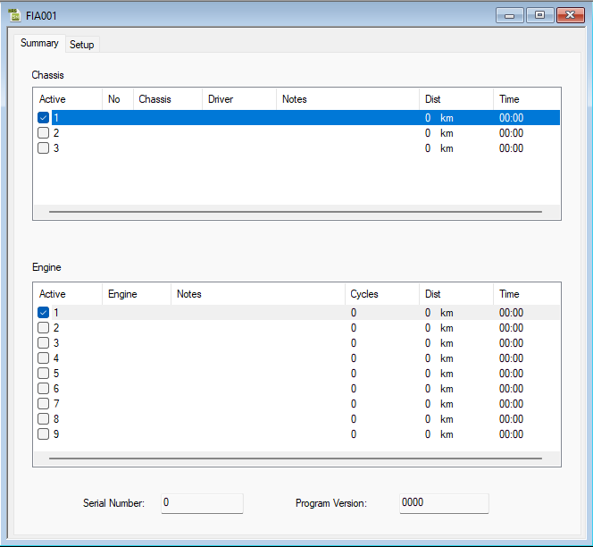

# History Report – Summary

The **Summary** tab of the [History Report dialog box](history-report-dialog-box.md) shows totals of statistics for all the Chassis and all the Engines for which history data has been obtained and gives access to detailed reports.

The [ASAP](../project-management/asap-compatibility.md) file defines the number of variants of Chassis and Engine for which history data is analysed. Each Chassis variant has a row in the **Chassis** panel and each Engine variant has a row in the **Engine** panel.

The check box in the **Active** column indicates which Chassis or Engine data set is currently being collected by the ECU. You can change this by selecting a different check box; the new setting is sent to the ECU immediately. If this fails, the previous selection is restored.

## Chassis panel

The Chassis panel has the columns **Active**, **No**, **Chassis**, **Driver**, **Notes**, **Dist** and **Time**. The No, Chassis, Driver and Notes columns contain text boxes to annotate the history data.

## Engine panel

The Engine panel has the columns **Active**, **Engine**, **Notes**, **Cycles**, **Dist** and **Time**. The text boxes are in the Engine and Notes columns. Click on a text box (or press F2) to open it for editing.

The **Dist**, **Time** and **Cycles** (Engine panel only) columns show the total distance, time and number of cycles run by the Engine or Chassis since the history data was last reset. (A cycle is two turns of the crank for a four-stroke engine.)

The **Serial Number** and **Program Version** of the ECU are shown below the panels.

## Detailed reports

- To see the [Chassis Details](history-report-chassis-details.md): select a row in the **Chassis** panel and press ENTER, or double-click the row.
- To see the [Engine Details](history-report-engine-details.md): select a row in the **Engine** panel and press ENTER, or double-click the row.

To send changes to the ECU select: **Tools** > **History Report** > **Download**.

**See also:** [History Report](index.md); [History Report – Setup](history-report-setup.md)
