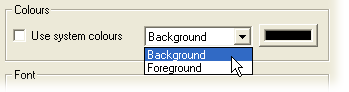

# Create a PCU Dash Configuration

The main steps needed to start using the PCU Dash Configuration are described below.

**To create a Dash Configuration:**

1. Open the project containing the PCU .pgv file. The project opens with the **PCU400Logger** Application in the Explorer, which contains the PCU Parameters.
2. Open a new PCU Dash Configuration window: select **Desktop** > **Window** > **Dashboard**. The window opens with a blank display area and a single page, **Page 1**. See [Requirements](requirements.md) if the command is not available.
3. Set the Background and Foreground colours. Select **Dash Properties** from the [Main Menu](pcu-dasbboard-window/dash-configuration-main-menu.md). On the **Display** tab, clear the **Use system colours** check box and select **Background** from the drop-down list. Click the colour button and select a colour. This sets the background colour of the display area on all pages. Set the Foreground colour in the same way; the foreground colour is used for values, display graphics and so on. Click **OK**.

    

4. Add a grid (optional). In the Dash Properties dialog box, select the **Layout** tab, select **Display Guide Grid** and enter a **Grid Size**. Click **OK**. The grid is drawn in the Foreground colour set on the Display tab.
5. Find the required Parameter in the PCU400Logger Application and drag it onto the display area. The Parameter is shown in a [Numeric Control](pcu-dasbboard-window/display-control-types/numeric-control.md) with the Parameter name, value and units in the Foreground colour. Only Measurement Parameters can be added.
6. Change the Control type if required. Right-click the Control and select a different Control type from the [Context menu](pcu-dasbboard-window/pcu-context-menus.md), for example **Bar Graph**. The Control changes to the selected type.
7. Configure the Control's appearance using its Properties dialog box (right-click the Control and select **Properties**). See the Display Control Types pages, starting with [Numeric Control](pcu-dasbboard-window/display-control-types/numeric-control.md).
8. Download the configuration to the PCU: select **Download Config** from the Main Menu and click **Yes** to confirm.

!!! note
    **Download Config** overwrites the configuration currently held on the display unit. It is only available while System Monitor is communicating with the car.
