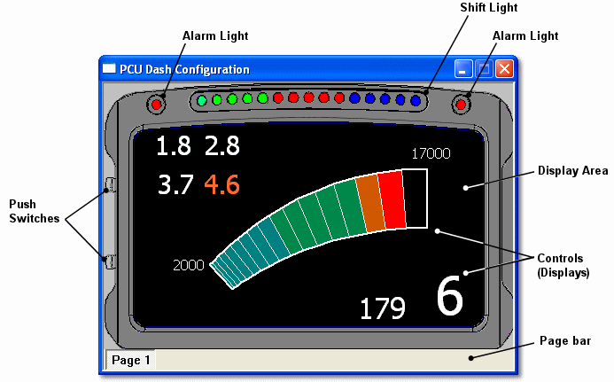

# PCU-400 Display Unit

The PCU-400 Display Unit is a small, lightweight driver display module which connects to the TAG-400, or a suitable third-party control unit, via CAN. The display unit presents the driver with numeric and graphical information on a TFT display screen.

The unit also has 15 LED shift lights, two alarm LEDs and two push switches on the housing. The push switches can be used to control the display, for example to change page or adjust the brightness of the LEDs.

## Display configuration

The [PCU Dash Config Window](pcu-dasbboard-window/pcu-dashboard-config-window.md) in System Monitor controls the layout of the text and graphics in the display area of the unit. The configuration is downloaded to the PCU-400 via an Ethernet connection.

The Dash Configuration also sets up the [shift lights](pcu-dasbboard-window/pcu-dash-properties/shift-lights-tab.md) and the [Actions](pcu-dasbboard-window/pcu-dash-properties/actions-tab.md) that respond to the push switches and drive the alarm LEDs.

**See also:** [Requirements](requirements.md), [Create a PCU Dash Configuration](create-a-pcu-dashboard-config.md)
