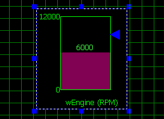
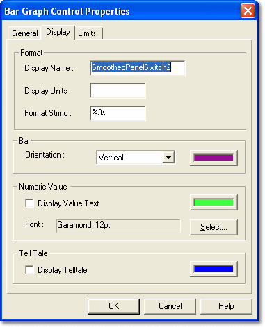
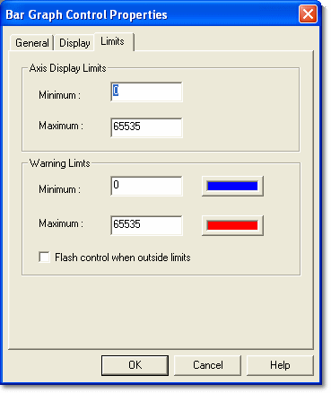

# Bar Graph Control

The Bar Graph Control provides a combined pictorial and numeric display of the instantaneous value of its associated Parameter.

The value of a single Parameter is shown by a coloured bar, and also numerically if **Display Value Text** is selected.

The bar colour indicates the Control's status. The bar is drawn in the colour set in the Bar panel of the Display tab, unless the value rises above or falls below the warning limits set on the Limits tab.

A telltale line can mark the highest value reached.

## Bar Graph Control Properties

Control properties apply only to the selected Control. Properties that apply to the whole Dash Configuration are described in [PCU Dash Properties](../pcu-dash-properties/index.md). To open the Bar Graph Control Properties, right-click the Control and select **Properties...**.

There are three tabs:

- **General** - Common to all Parameter Controls; described in [Numeric Control](numeric-control.md#general-tab).
- [Display](#display-tab)
- [Limits](#limits-tab)

### Display tab

**Format**

- **Display Name** - The name shown beneath the bar. Defaults to the Parameter name.
- **Display Units** - The units shown after the Display Name. Defaults to the Parameter's units.
- **Format String** - The format of the Parameter value, for example 0.000.

**Bar**

- **Orientation** - Select **Vertical** or **Horizontal**. Click the colour button to choose the bar colour.

**Numeric Value**

- **Display Value Text** - When selected, the Parameter value is shown on the bar. Click the colour button to choose the colour of the value text. Cleared by default.
- **Font** - The font used for the value text. Click **Select...** to choose the font style and size.

**Tell Tale**

- **Display Telltale** - When selected, a telltale line is drawn on the bar at the highest value reached. Click the colour button to choose its colour. Cleared by default.

### Limits tab

**Axis Display Limits**

- **Minimum**, **Maximum** - The minimum and maximum values shown on the bar. Default to the Parameter's physical limits. **Maximum** must be greater than **Minimum**.

**Warning Limits**

The bar changes to a warning colour when the value is outside the warning limits. The limits and colours default to the Parameter's range limits and low/high colours.

- **Minimum** - Below this value, the bar is shown in the lower warning colour. Click the colour button to choose the colour.
- **Maximum** - Above this value, the bar is shown in the upper warning colour. Click the colour button to choose the colour. **Maximum** must be greater than **Minimum**.
- **Flash control when outside limits** - When selected, the Control flashes while the value is outside the warning limits.
