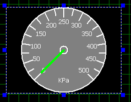
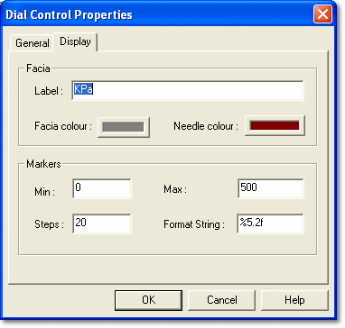

# Dial Control

The Dial Control provides a pictorial display of the instantaneous value of its associated Parameter.

The number of steps on the dial facia is set in the Dial Control Properties. The font used for the step markers is scaled as the Control is made larger or smaller.

## Dial Control Properties

Control properties apply only to the selected Control. Properties that apply to the whole Dash Configuration are described in [PCU Dash Properties](../pcu-dash-properties/index.md). To open the Dial Control Properties, right-click the Control and select **Properties...**.

There are two tabs:

- **General** - Common to all Parameter Controls; described in [Numeric Control](numeric-control.md#general-tab).
- [Display](#display-tab)

### Display tab

**Facia**

- **Label** - The label shown at the bottom of the dial. Defaults to the Parameter's units.
- **Facia colour** - The colour of the dial facia. Defaults to the Control's background colour.
- **Needle colour** - The colour of the needle. Defaults to the Control's foreground colour.

!!! note
    The dial markers and their values are drawn in the foreground colour set on the General tab.

**Markers**

- **Min**, **Max** - The minimum and maximum values shown on the dial. **Min** must be less than **Max**.
- **Steps** - The number of steps the dial is divided into. The range between **Min** and **Max** is divided equally. The default is 20.
- **Format String** - The format of the marker values, for example 0.000. Defaults to the Parameter's format.
