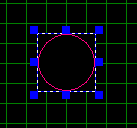
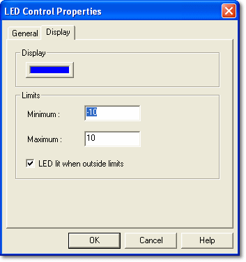

# LED Control

The LED Control indicates the status of its associated Parameter.

The LED is lit when the Parameter value is outside (or, if set, inside) the Minimum and Maximum limits set in the LED Control Properties.

## LED Control Properties

Control properties apply only to the selected Control. Properties that apply to the whole Dash Configuration are described in [PCU Dash Properties](../pcu-dash-properties/index.md). To open the LED Control Properties, right-click the Control and select **Properties...**.

There are two tabs:

- **General** - Common to all Parameter Controls; described in [Numeric Control](numeric-control.md#general-tab). The Font panel is not shown for LED Controls.
- [Display](#display-tab)

### Display tab

**Display**

Click the colour button to choose the colour of the LED when lit.

**Limits**

- **Minimum**, **Maximum** - The limits for switching the LED on or off. Default to the Parameter's range limits.
- **LED lit when outside limits** - When selected (the default), the LED is lit when the value is below Minimum or above Maximum. When cleared, the LED is lit when the value is between Minimum and Maximum.
