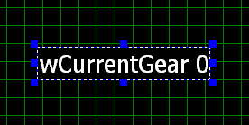
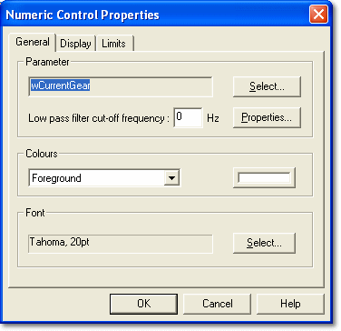
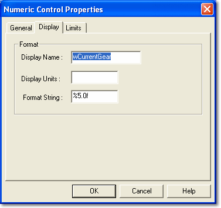
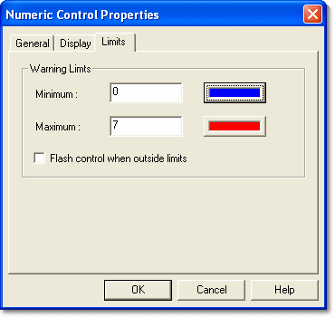

# Numeric Control

The Numeric Control displays the instantaneous engineering value of a Parameter in numeric format.

By default the Control shows the Parameter name, its current value and its units. The name, units and number format can all be changed in the Numeric Control Properties. When **Automatic Sizing** is selected on the General tab, the font is scaled as the Control is made larger or smaller.

This Control is typically used to display the vehicle's current gear.

## Numeric Control Properties

Control properties apply only to the selected Control. Properties that apply to the whole Dash Configuration are described in [PCU Dash Properties](../pcu-dash-properties/index.md). To open the Numeric Control Properties, right-click the Control and select **Properties...**.

There are three tabs:

- [General](#general-tab)
- [Display](#display-tab)
- [Limits](#limits-tab)

### General tab

The General tab is common to the Numeric, Bar Graph, Rev Bar, Dial and LED Controls.

**Parameter**

- The name of the Parameter currently associated with the Control.
- **Select...** - Opens the Select Parameter dialog box, where you can select a different Parameter for the Control.
- **Properties...** - Opens the [Properties](../../../using-system-monitor/parameters/parameter-properties/index.md) of the Parameter.
- **Low pass filter cut-off frequency** - Enter a cut-off frequency in Hz. A value of 0 Hz (the default) has no effect.

**Colours**

Sets the background and foreground colours of the Control. The foreground colour is used for values, display graphics and so on. Select **Foreground** or **Background** from the drop-down list, then click the colour button to choose a colour. New Controls take the Dash Configuration's colours.

**Font**

Shows the font used by the Control. Click **Select...** to choose the font style and size. The text is drawn in the foreground colour. This panel is not shown for LED Controls.

**Automatic Sizing**

Shown for Numeric Controls only. When selected, the font is fitted to the Control when you resize it, and the Control is resized to fit its text when you change the font, name, units or format. Cleared by default.

### Display tab

**Format**

- **Display Name** - The text shown in front of the Parameter value. Defaults to the Parameter name. Leave blank to show the value only.
- **Display Units** - The units shown after the Parameter value. Defaults to the Parameter's units.
- **Format String** - The format of the Parameter value, for example 0.000. Defaults to the Parameter's format.

### Limits tab

**Warning Limits**

The value is shown in the foreground colour set on the General tab while it is within the warning limits, and in a warning colour when it is outside them. The limits and colours default to the Parameter's range limits and low/high colours.

- **Minimum** - Below this value, the value is shown in the lower warning colour. Click the colour button to choose the colour.
- **Maximum** - Above this value, the value is shown in the upper warning colour. Click the colour button to choose the colour.
- **Flash control when outside limits** - When selected, the Control flashes while the value is outside the warning limits.
